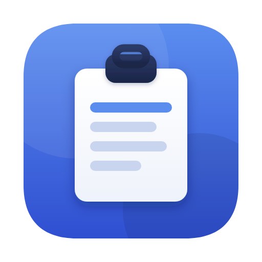

<p align="center">
  
</p>

<h1 align="center">Keepit – Clipboard Manager</h1>

<p align="center">
  Everything you copy, one hot key away. History, templates, Touch ID lock and encrypted storage — all on your Mac, no Keepit cloud. Encrypted backups to a folder of yours, like the update check, are optional and off by default.<br>
  <a href="https://keep.it.com"><b>keep.it.com</b></a> · <a href="docs/GUIDE.md">User guide</a> · <a href="docs/SECURITY.md">Security</a> · <a href="https://github.com/andrey-insarov/Keepit/releases/latest">Download for macOS</a> · Free &amp; open source (MIT)
</p>

<p align="center">
  <a href="https://github.com/andrey-insarov/Keepit/releases/latest"></a>
  <a href="https://github.com/andrey-insarov/Keepit/actions/workflows/build.yml"></a>
  
  
</p>

**Keepit** is a native macOS clipboard history and template manager made by the team behind the
[it.com](https://it.com) domain zone. Press `⌥M` in any app to paste anything you copied recently;
`⌥T` for your templates. Images, files and rich text are kept too. Optional password protection
stores everything AES-256 encrypted, unlocks with Touch ID, and comes with a 24-word recovery phrase.
Clipboard data marked concealed by the copying app is not recorded, and known password managers are excluded. No account, no Keepit cloud, no analytics.

Keepit started as a macOS take on the workflow of [CLCL](https://github.com/nakkag/CLCL), Ohno
Tomoaki's Windows clipboard tool, and has since been rewritten and extended into an app of its own,
with ideas drawn from many clipboard and snippet managers. It contains no CLCL code and is not
affiliated with its author — see [docs/ORIGINS.md](docs/ORIGINS.md).

## Install

Homebrew:

```bash
brew tap andrey-insarov/keepit https://github.com/andrey-insarov/Keepit
brew install --cask andrey-insarov/keepit/keepit
```

(If Keepit was installed by hand before, Homebrew refuses to overwrite `/Applications/Keepit.app` — quit
Keepit and move that copy to the Trash first, or add `--force`.)

Or the DMG:

* **Download**: grab `Keepit-<version>.dmg` from the [latest release](https://github.com/andrey-insarov/Keepit/releases/latest),
  open it and drag Keepit to Applications. Signed and notarized; updates itself.
* **Mac App Store**: in review (2.11.1); the link will appear here once it is live.
* **Build it yourself**: see below.

## Features

* **History menu** — `⌥M` opens next to the text cursor; type to search, pick with the mouse or press 1–9 / A–Z; `⌃⌥1…0` paste items 1–10 without the menu. Hover for a preview panel; hold `⇧` for an extended menu (plain text, UPPERCASE / lowercase / Title Case / Sentence case, trimmed, single line, copy only, add to Templates, delete).
* **Everything is kept** — plain text, RTF, HTML, images with thumbnails, file lists. Duplicates are merged; separate limits for text/file items and images; forget items older than N.
* **Paste queue** — `⌥N` starts it, every ⌘C adds to a counter in the menu bar, `⌥V` pastes the items back one by one in the same order, `⌥⇧N` pastes all remaining joined with a separator.
* **Templates** — folders, `-` separators, `&x` menu shortcuts, per-template hot keys, any format. Placeholders fill in at paste time: `{date…}`, `{time}`, `{clipboard}` with transforms, `{input:…}`, `{choice:a|b}`, `{cursor}`. An *Examples* folder on first launch.
* **Viewer** — tree of Clipboard / History / Template, search with highlighted matches, in-place editing, hex dump, drag history into templates, save any format to a file.
* **Private by design** — password-protected AES-256-GCM storage, Touch ID unlock, 24-word recovery phrase, an on-screen keyboard for the password (shuffled keys, no key events), lock on screen lock / sleep; concealed clipboard data is not recorded and known password managers are excluded by app (best effort — [how it works](https://keep.it.com/security#what-is-not-recorded)); per-app ignore list; no account; no network except the daily update check, which can be switched off (none in the App Store edition).
* **Backup** — automatic encrypted copies into a folder you choose (iCloud Drive, Dropbox, a disk): complete `.keepit` files, rotated, opened with your Keepit password or recovery phrase on any Mac; restore offered on first launch, Merge or Replace. Plus one-off Export / Import by hand. Open, documented format ([docs/FORMAT.md](docs/FORMAT.md)).
* **Settings the Mac way** — General / Shortcuts / Paste Queue / History / Menu / Security / Advanced; every change applies at once; hot-key recorders with conflict checks; per-app paste key (⌘⇧V, ⌃V…).
* **Automation** — `keepit://` URL scheme: `paste/N`, `copy/N`, `template/Name`, `add?text=`, `add-template?text=&name=`, `history`, `templates`, `viewer`, `settings`, `pause`, `resume` — from Shortcuts (“Open URL”), Raycast, Alfred or `open`. Off by default; switch on in Settings → Advanced. Commands that change something are confirmed when they come from a web browser or an unknown sender.
* **21 interface languages** — en, ru, uk, de, fr, es, it, pt-BR, nl, pl, cs, tr, lt, lv, et, ja, ko, zh-Hans, zh-Hant, ar, he.
* Menu-bar only, launch at login, universal binary (Apple silicon + Intel), signed and notarized, self-updating (Sparkle) in the direct edition.

## Build

Requirements: macOS 13+, Xcode Command Line Tools (`xcode-select --install`).

```bash
make app        # → Keepit.app in the project folder
make run        # build and launch
make install    # copy to /Applications
make dmg        # → Keepit-<version>.dmg (drag-and-drop installer with Applications shortcut)
make dist       # → both the .dmg and a .zip, as attached to GitHub Releases
make notarize SIGN_ID="Developer ID Application: …" NOTARY_PROFILE=…   # signed + notarized (see RELEASING.md)
```

Or in Xcode: `open Package.swift` and run the `Keepit` scheme (the `LSUIElement` key in
`Resources/Info.plist` is only applied by the `make app` bundle; from Xcode you'll also see a Dock icon). Bundle id: `com.it.keep`.

## First launch

1. macOS will ask for the **Accessibility** permission (System Settings → Privacy & Security →
   Accessibility). It is required to send `⌘V` to the active app and to place the menu at the
   text cursor. Without it Keepit still records history and copies the chosen item to the clipboard.
2. Press `⌥M` in any text field — the history menu appears; pick an item, it is pasted.
3. Press `⌥T` for templates, `⌥E` for the Viewer (or right-click the menu-bar icon), `⌥S` for Settings.

## Viewer

* Left: tree. **Clipboard** is the live pasteboard (read-only). **History** and **Template** items
  expand into their formats (TEXT, RTF, HTML, PNG, FILE LIST).
* Right: the selected format. Text, RTF and HTML are editable; the edit is applied when the editor
  loses focus. Editing TEXT drops stale RTF/HTML from that item. **Binary** toggles a hex dump.
* `↩` sends the selected item (or single format) to the clipboard; `⌫` deletes it. Right-click for
  the full menu. Drag history items onto the Template tree to register them.
* Template names: `-` makes a separator in the popup menu, `&G` makes `G` the shortcut, `&&` is a
  literal ampersand; an empty name shows the item's contents instead (*Clear Name*).
* *Set Hot Key…* on a template item pastes it directly, without a menu.

### Accessibility permission resets after rebuild

If you have a Developer ID certificate, build local test copies with the same identity as the
release and the permission survives every rebuild:

```bash
make install SIGN_ID="Developer ID Application: Your Company (TEAMID)"
```


`make app` signs the bundle ad-hoc (`SIGN_ID=-`). macOS ties the Accessibility grant to the code
signature, so after each rebuild you may need to toggle Keepit off/on in the Accessibility list.
To avoid that, create a self-signed "Code Signing" certificate in Keychain Access (e.g. named
`Keepit Dev`) and build with:

```bash
make app SIGN_ID="Keepit Dev"
```

## Password protection (2.0)

Settings → *Require password at launch, encrypt history & templates*. You set a password once;
from then on Keepit asks for it at every launch (three wrong attempts → quit) and nothing is loaded
until it is entered. `history.json` and `templates.json` are then stored as AES-256-GCM blobs
(key = PBKDF2-HMAC-SHA256, 200 000 rounds, random 16-byte salt kept in `vault.json` together
with a sealed verifier, plus the KDF name and round count). The password itself is never written anywhere; without it, the only way back in is the recovery phrase below.
`settings.json` stays in plain text (it holds no clipboard data). *Password → Change…* re-encrypts;
unticking the option asks for the password and writes the files back as plain JSON.

### Touch ID

Settings → *Unlock with Touch ID*. The data key is stored in the data-protection keychain behind
a `biometryCurrentSet` access control (Secure Enclave backed; invalidated if fingerprints change),
so at launch or after *Lock* a fingerprint fetches the same key the password would derive — the
password is always available as a fallback ("Use Password" on the prompt). Changing the password
refreshes the entry; turning protection off removes it. Requires a Team-ID-signed build (release
or `make install SIGN_ID=…`); ad-hoc builds say so and keep using the password.

### Recovery phrase

Turning protection on shows a 24-word recovery phrase (standard BIP-39 English list with
checksum). A key derived from the phrase (HKDF) wraps the data key inside `vault.json`; the phrase
itself is never stored. Print it (the dialog offers the system print panel, which can also save a
PDF) and keep it offline — anyone holding it can read the history. If you forget the password,
the unlock prompt's *Recovery Access…* unlocks the data and immediately asks for a new
password. The phrase keeps working after password changes; *Recovery phrase → Create New…* in Settings
replaces it (the old sheet becomes useless). Lose both password and phrase and the data is
unrecoverable — by design.

### Key handling and locking

* The derived key lives in a dedicated buffer, `mlock`ed where the kernel allows it, and is wiped with
  `memset_s` when Keepit locks, when the password is changed/removed, and at quit. A CryptoKit
  `SymmetricKey` is created only for the duration of one encrypt/decrypt call and its temporary
  copy is wiped afterwards. Password bytes and the PBKDF2 output buffer are wiped right after
  key derivation.
* The password dialog uses a custom field (`SecurePasswordField`): every key press is converted to
  UTF-8 and appended straight into an `mlock`ed `SecureBuffer`; only bullets are drawn. No `String`
  holding the password is ever built, paste/copy are disabled, backspace wipes the removed bytes,
  the "repeat password" check is a constant-time byte compare, and the buffer is wiped as soon as
  the key is derived. Limitation: input methods / dead-key composition are not supported — type
  the password with a plain keyboard layout. (What remains outside our control is the one-character
  `NSEvent.characters` string macOS creates per key press.)
* **Lock Keepit** (menu-bar icon → *Lock Keepit*, `⌥L`): wipes the key, unloads history and templates
  from memory, stops watching the clipboard and unregisters hot keys. The icon turns into a lock;
  click it → *Unlock Keepit…* to enter the password and resume. Pending edits are saved (encrypted)
  before the key is wiped.
* *Lock Keepit when the screen locks or the Mac sleeps* (Settings, on by default) does the same
  automatically on screen lock, fast user switch and sleep.
* While locked, nothing is decrypted and the hot keys do nothing. What is on the system
  clipboard itself is of course still readable by every app — that is outside Keepit's control.

## Updates

Releases outside the App Store update themselves through Sparkle: once a day Keepit checks the
latest GitHub Release and offers the new version; *Check for Updates…* in the menu does it on
demand. Downloads are EdDSA-signed in addition to the Developer ID signature (see RELEASING.md).
The check is optional — *Settings → General → Updates*; off, Keepit makes no network request at
all and the menu item is gone.

### Verifying a download

Every release ships `Keepit-<version>.dmg.sig` (detached Sparkle EdDSA signature, same key the
updater trusts) and `SHA256SUMS`:

```bash
shasum -a 256 -c SHA256SUMS                       # checksum
spctl -a -vv -t install Keepit-<version>.dmg      # Developer ID + notarization
# EdDSA: Sparkle's `sign_update --verify` or any Ed25519 tool with the public key
# SNDhdllyP4tjshG0ke1rJ3YkGSqsdS0G0ZG7SBtXu7E=
```

## Testing

* `swift test` — unit tests (models, menu parsing, settings, history/template stores, vault
  encryption and key zeroization). Runs on every push in GitHub Actions.
* `Keepit --selftest` — end-to-end smoke test inside the real app: captures a clipboard change,
  checks dedupe, inserts a template, builds the menus, opens the Viewer and Settings and saves
  PNG snapshots of them to `selftest-output/`, round-trips the vault. Set `KEEPIT_DATA_DIR` to a
  temporary folder so your real data is untouched. CI runs it on every build and uploads the
  snapshots as an artifact (Actions → run → *selftest-…*), so UI regressions can be eyeballed.
* Hot keys, synthetic ⌘V and the caret lookup need the Accessibility permission and a real user
  session, so they can't run on a CI runner — test those by hand (or let Claude do it on a
  linked Mac) before tagging a release.

## Icon

`Resources/Icon/icon.svg` is the source; `make icon` re-renders `AppIcon.icns` (all sizes, PNG-packed)
with the Playwright/Chromium script, or on a Mac render the PNGs any way you like and run
`iconutil -c icns AppIcon.iconset`. The `.icns` is committed so the CI build doesn't need a renderer.

## Files

```
~/Library/Application Support/Keepit/
  settings.json    options (editable by hand; missing keys fall back to defaults)
  history.json     clipboard history (base64 data per format)
  templates.json   template tree
  vault.json       KDF parameters, salt + verifier, recovery material — only when password protection is on
```

Example `pasteKeys` override in `settings.json` (an app that pastes with ⇧⌘V):

```json
"pasteKeys": {
  "com.example.someterminal": { "keyCode": 9, "command": true, "shift": true, "option": false, "control": false }
}
```

## Architecture

```
Sources/Keepit/
  main.swift                   NSApplication bootstrap
  AppDelegate.swift            menu-bar icon, hot-key dispatch, popup menus, actions, lock/unlock
  Models/                      ClipItem (one entry with its formats), TemplateNode, Settings, AppInfo
  Core/                        ClipboardMonitor (changeCount polling), HistoryStore, TemplateStore,
                               PasteQueue, HotKeyManager (Carbon), Paster (CGEvent + caret lookup),
                               Storage, Vault (PBKDF2 → AES-GCM), BiometricUnlock, Backup, Snippets, Limits
  UI/                          MenuBuilder, PreviewPanel, SettingsWindow, HotKeyRecorderView,
                               ViewerWindow, FormatViews, SnippetPromptDialog, SecurePasswordField
  URLCommands.swift            keepit:// scheme
  Uninstall.swift              Reset… / Uninstall…
```

The historical map from CLCL's C sources to these files is in [docs/ORIGINS.md](docs/ORIGINS.md).

## Platform notes

* **Clipboard listener**: macOS has no change notification; polling `changeCount` every 0.3 s
  costs essentially nothing (it is an integer read).
* **Low-level keyboard hook** (`WH_KEYBOARD_LL`) is not needed: Carbon hot keys deliver the
  event only to us, and `NSMenu` handles the digit/letter accelerators natively.
* **Focus**: an `NSMenu` needs our process to be active to receive keyboard input, so we activate
  on hot key, remember the previous app, and re-activate it before sending `⌘V` (or on cancel).
* **Modifier bleed**: if `⌥` is still held when `⌘V` is synthesized the target gets `⌥⌘V`;
  `Paster` waits (up to ~1.2 s) for all modifiers to be released first.

## Roadmap

**3.0 — on `release/3.0`, tag pending**

1. **Automatic encrypted backup to your own cloud folder** — iCloud Drive, Google Drive, Dropbox or
   any folder: complete `.keepit` files written a few minutes after each change, rotated, opened with
   your Keepit password or recovery phrase on any Mac; restore offered on first launch, Merge or
   Replace. No Keepit server, the provider only ever sees ciphertext. (No merge on start: a backup
   is restored only when you ask — design notes in [docs/BACKUP.md](docs/BACKUP.md).)
2. ~~Paste queue~~ — shipped in 2.10.
3. **`KeepitCore`** — the container format, key derivation and compression split into their own
   target without AppKit, the first step towards a companion that reads the same encrypted backup.
4. **Open `.keepit` format** — [docs/FORMAT.md](docs/FORMAT.md) is the specification; the
   repository carries reference files produced by an independent Python implementation.

**3.1**

- **Import from other managers** — only open, documented formats; closed CloudKit-backed stores
  (Paste, Pastebot, PastePal) are left alone. History: Maccy (SQLite), Alfred (`clipboard.alfdb`),
  Flycut (plist), CLCL (`history.dat`). Snippets → templates, with placeholder conversion: Alfred
  (`.alfredsnippets`), Raycast (JSON export), Clipy/ClipMenu (XML), TextExpander / aText / Espanso,
  CLCL (`regist.dat`). *Viewer → Import…* detects what is installed and offers it in one click.
- **Reference CLI** for the `.keepit` format (read, write, inspect) so other tools on any platform
  can import or export Keepit data; template export to Espanso, so snippets travel to Windows and
  Linux without a Keepit port.
- Format filter & priority pages (which formats to keep / show first).
- The rest of `KeepitCore` (data model, vault, placeholders) for an iOS companion — templates
  keyboard, history viewer, Share Sheet — built as its own project against the same backup.

**Later**

- Tools/plugin equivalents (shell scripts or AppleScript on an item, from the menu).

## License

MIT. Keepit contains no CLCL code; `LICENSE` keeps the CLCL copyright line as a credit to the
idea Keepit started from, alongside `Copyright (c) 2026 UK Intis Telecom LTD (Andrey Insarov)`.
