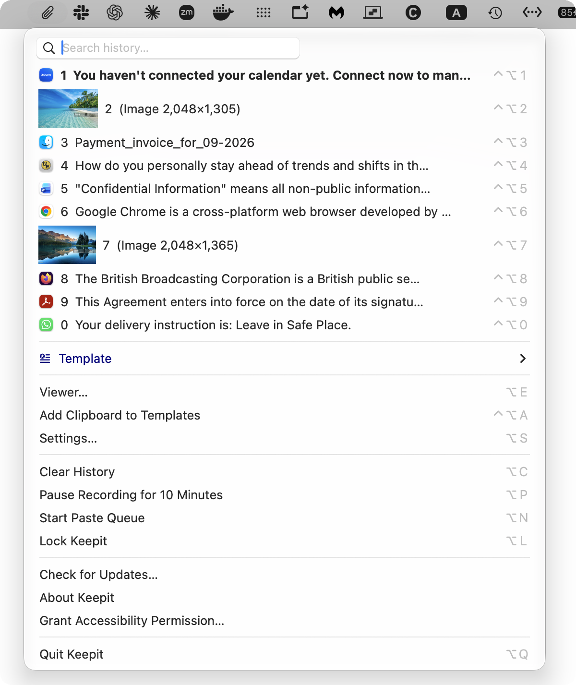

# How to see your clipboard history on a Mac

Whether your Mac keeps a clipboard history depends on the version of macOS. Since macOS Tahoe (26), Spotlight keeps a short history of what you copied; every earlier version keeps exactly one item, and copying something else replaces it. This page shows how to open the built-in history, what it does not keep, and how to get a full, searchable clipboard history with a free app — on any Mac running macOS 13 or later.

## The built-in clipboard history in macOS Tahoe

In macOS 26 Tahoe, clipboard history lives inside Spotlight:

1. Press `⌘Space` to open Spotlight.
2. Press `⌘4` (or click the clipboard icon) to switch Spotlight to clipboard mode. The first time, macOS may ask you to turn clipboard history on; you can also do that in *System Settings → Spotlight*.
3. Scroll or type to find an item, then choose it to paste it into the app you came from.

What to know before relying on it:

- **Items expire.** By default an item disappears eight hours after you copied it. macOS 26.1 lets you choose 30 minutes, 8 hours or 7 days in *System Settings → Spotlight* — nothing longer.
- **It keeps text without formatting.** Rich text comes back as plain text. Images, links and files do appear in the list.
- **It needs a Mac that runs macOS 26.** On Ventura, Sonoma and Sequoia there is no history at all.
- **It is a Spotlight panel**, so pasting means opening Spotlight, switching mode, picking an item, and returning to your document.
- Copies from Apple's Passwords app are left out; other apps vary.

For many people that is enough. If you want formatting kept, items that outlive the window you set, templates, a menu at the text cursor instead of a Spotlight round-trip, or a Mac that cannot run macOS 26, read on.

## Earlier versions of macOS: one item only

On macOS 13 Ventura, 14 Sonoma and 15 Sequoia the clipboard holds exactly one thing, and there is no history to open, scroll or search. What macOS can do:

**See the current item.** In Finder, choose *Edit → Show Clipboard*. A small window shows whatever is on the clipboard right now — one item, read-only. It is useful for checking what you are about to paste, nothing more.

**Paste the same thing on another Apple device.** Universal Clipboard copies the clipboard between a Mac, an iPhone and an iPad signed in to the same Apple ID. Still one item.

**Paste without formatting.** Most apps have *Edit → Paste and Match Style* (`⌥⇧⌘V`), which pastes the clipboard as plain text.

Once you have copied over something, the only way back is to find the original and copy it again.

## A full clipboard history with Keepit

[Keepit](/) is a free, open-source clipboard manager for Mac (macOS 13 or later). Once it is running in the menu bar, everything you copy — text with its formatting, images, files — is kept in a history you can open from any app, and it stays there until you delete it or it falls off the end of the list.

1. [Download Keepit](https://github.com/andrey-insarov/Keepit/releases/latest) (or `brew install --cask andrey-insarov/keepit/keepit`), move it to Applications and open it.
2. Grant the Accessibility permission when asked. Keepit needs it to paste for you and to open the menu at your text cursor; it does not read other apps.
3. Press `⌥M` anywhere. The history menu opens next to the cursor with the most recent items first.

From the menu:

- **Type** to search the history; the list filters as you type.
- **Press a number** (1–0) or click an item: it is pasted where you were typing, and the menu closes.
- **Hover** over an item to see a preview of long text or an image.
- Press `⌃⌥1` … `⌃⌥0` without opening the menu to paste items 1–10 straight away, or `⌥⇧V` to paste the item before the current one.

The history keeps the last 1 000 text and file items and the last 30 images by default; both limits are yours to change in *Settings → History*. Duplicates are merged; clipboard data marked concealed is not recorded, and copies from known password managers are excluded.

### Spotlight's history and Keepit side by side

| | Spotlight (macOS 26) | Keepit |
|---|---|---|
| Runs on | macOS 26 Tahoe | macOS 13 Ventura or later |
| How long items are kept | 30 minutes, 8 hours or 7 days | Until you delete them; 1 000 text and file items and 30 images by default, both adjustable |
| Text formatting | Dropped | Kept, with a one-key plain-text paste |
| Opening the history | Spotlight window, `⌘Space` then `⌘4` | A menu at the text cursor, `⌥M` |
| Pasting | Pick an item in Spotlight | Number keys in the menu; `⌃⌥1`–`⌃⌥0` without opening it; a paste queue for several items in a row |
| Templates | — | Reusable snippets with date, input and choice placeholders |
| Password and Touch ID | — | Optional: history encrypted with AES-256-GCM, unlocked with Touch ID |
| Backup | — | Encrypted backup to a folder you choose |

The two do not get in each other's way: Keepit records what you copy whether or not Spotlight's history is on.

## Clipboard history and privacy

A clipboard history is a record of everything you copy, so where it is stored matters. Keepit keeps it in one folder on your Mac — no account, no Keepit server, no analytics. Backups are optional: switch them on and encrypted copies go to a folder you choose, which iCloud Drive or Dropbox may sync under your own account. Turn on a password and the history is stored AES-256-GCM encrypted and unlocked with Touch ID. The [security page](/security) has the details.

## Related

- [The user guide](/guide) — everything Keepit can do, with screenshots.
- [How to paste as plain text on a Mac](/paste-as-plain-text-mac)
- [How to clear the clipboard on a Mac](/clear-clipboard-mac)
