# Keepit user guide

Keepit is a clipboard history and template manager for macOS. It lives in the menu bar, remembers
everything you copy, and pastes any of it back with a hot key. All shortcuts below are the defaults;
each can be changed in *Settings → Shortcuts*. This guide describes Keepit 3; the guide for
Keepit 2.x is kept unchanged at [keep.it.com/v2/guide](https://keep.it.com/v2/guide).


**Contents**

- [Part 1 — Getting started](#part-1--getting-started): [Install](#install) · [First launch](#first-launch)
- [Part 2 — Everyday use](#part-2--everyday-use): [The history menu](#the-history-menu) · [Search and preview](#search-and-preview) · [Paste without the menu](#paste-without-the-menu) · [The paste queue](#the-paste-queue) · [The extended menu](#the-extended-menu)
- [Part 3 — Templates](#part-3--templates): [Creating and organising](#creating-and-organising) · [Placeholders](#placeholders) · [Templates that ask questions](#templates-that-ask-questions)
- [Part 4 — The Viewer](#part-4--the-viewer)
- [Part 5 — Settings](#part-5--settings)
- [Part 6 — Security](#part-6-security): [Password and encryption](#password-and-encryption) · [Touch ID](#touch-id) · [Recovery phrase](#recovery-phrase) · [Backup](#backup)
- [Part 7 — Advanced](#part-7--advanced): [Automation](#automation-the-keepit-url-scheme) · [Updates](#updates) · [Uninstalling](#uninstalling)
- [Reference](#reference): [Troubleshooting](#troubleshooting) · [Keyboard cheat sheet](#keyboard-cheat-sheet) · [Placeholder cheat sheet](#placeholder-cheat-sheet)

---

## Part 1 — Getting started

### Install

**Homebrew** — recommended, because `brew upgrade` keeps it current:

```bash
brew tap andrey-insarov/keepit https://github.com/andrey-insarov/Keepit
brew install --cask andrey-insarov/keepit/keepit
```

**DMG** — download `Keepit-<version>.dmg` from the
[latest release](https://github.com/andrey-insarov/Keepit/releases/latest), open it and drag Keepit
into *Applications*.


The first time you open the app, macOS confirms that it came from the Internet and was checked by
Apple. Click *Open*.


Keepit is signed and notarized, updates itself, and runs natively on Apple silicon and Intel Macs
with macOS 13 Ventura or newer.

### First launch

Keepit is a menu-bar app: no Dock icon, no window until you open one. After the first launch the 📎
icon appears in the menu bar, and Keepit asks three things.

**1. Restore from a backup?** If this is a new Mac and you have a Keepit backup — an automatic one
in iCloud Drive or another folder, or an exported `.keepit` file — *Restore from Backup…* brings
your history and templates back before anything else happens; you unlock the file with the
password of the Mac it came from, or its recovery phrase. *Start Fresh* skips this; the same
restore is available later from *Settings → Backup → Restore…*, and double-clicking a
`.keepit` file in the Finder opens it too. [Backup](#backup) has the details.

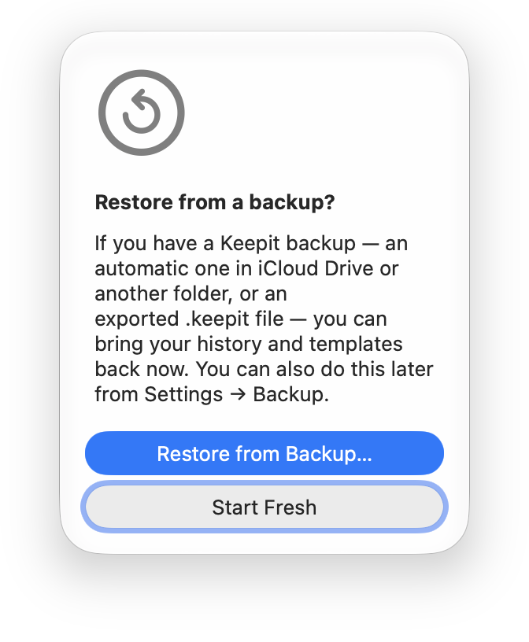

**2. A password (optional).** Keepit can store the history and templates encrypted and unlock with
Touch ID. You can decide now or later in *Settings → Security*; [Part 6](#part-6-security)
explains how it works. *Not Now* keeps everything unencrypted on disk. If you restored a backup
with its password a moment ago, Keepit offers to keep that password for this Mac.


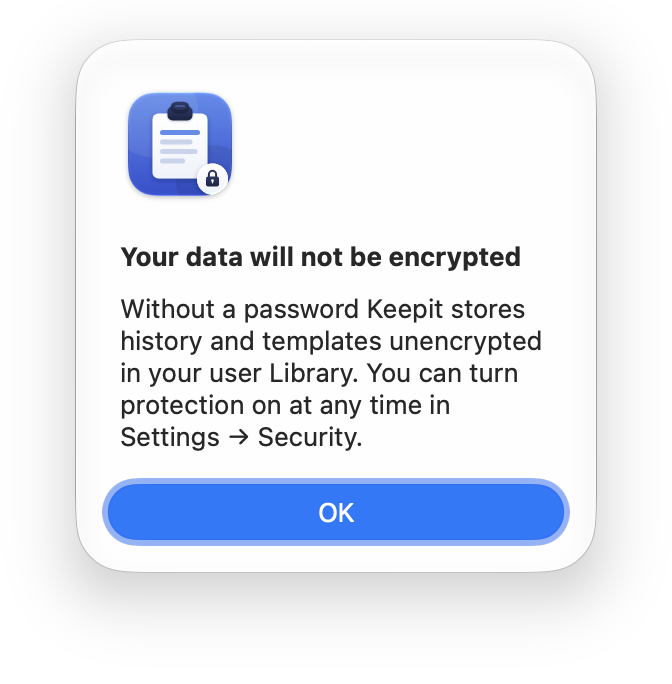

**3. The Accessibility permission.** To paste for you, Keepit sends ⌘V to the app you were working
in; macOS allows that only for apps listed under *System Settings → Privacy & Security →
Accessibility*. Click *Open System Settings* and switch Keepit on. Without it Keepit still records
and copies, but you press ⌘V yourself.


Keepit starts at login by default — *Settings → General* switches that off.

---

## Part 2 — Everyday use

### The history menu

Press **⌥M** in any app, or click the 📎 icon. The menu opens at your text cursor when Keepit can
find it, otherwise at the mouse pointer.

Each line is one clip, newest first. The newest one is **bold** — it is what is on the clipboard
right now. The icon shows the app you copied from; a title ending in `…` has more lines than the
menu shows. Images show a thumbnail, file lists show the file names.

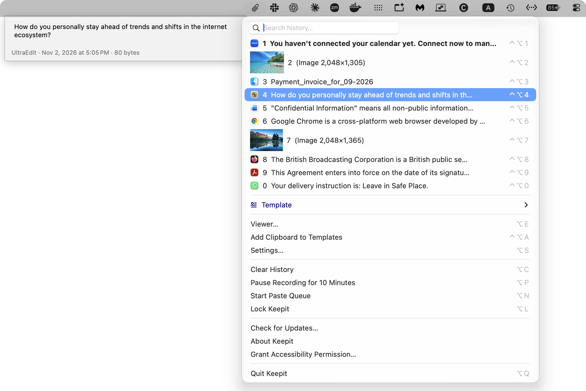


To paste an item: click it, or move to it with ↑ ↓ and press Return, or press its number with
**⌃⌥** — `⌃⌥3` pastes item 3. The same key works from anywhere, without opening the menu.

Below the history: the *Template* submenu, the Viewer (⌥E), Settings (⌥S), *Clear History* (⌥C),
*Pause Recording for 10 Minutes* (⌥P — for typing something you do not want recorded), *Lock Keepit*
(⌥L) when a password is set, and the updater. **⌥T** opens the template menu on its own; every one
of these keys also works without the menu.

### Search and preview

**Search.** Start typing while the menu is open: the field at the top filters the list by title and
by full text, so a line in the middle of a long clip is found too. Return pastes the first match;
Esc clears the field, and a second Esc closes the menu.

**Preview.** Hover over an item (or move to it with the keyboard) and a panel beside the menu shows
the full image, or the first lines of a long text, with the source app, date and size. Short
one-line texts have no preview — the menu line already shows them whole.


### Paste without the menu

Global hot keys act on the history as it is right now — item 1 is the clipboard — from any app:

| Keys | What happens |
|------|--------------|
| `⌃⌥1` … `⌃⌥9`, `⌃⌥0` | Paste history item 1–10 |
| `⌥⇧V` | Paste the *previous* item (item 2); press again to swap back |
| `⌃⌥V` | Paste the clipboard as plain text, formatting stripped |
| `⌃⌥U` `⌃⌥L` `⌃⌥T` `⌃⌥S` | Paste the clipboard as UPPERCASE / lowercase / Title Case / Sentence case |
| `⌃⌥W` | Paste the clipboard trimmed of leading and trailing whitespace |
| `⌃⌥J` | Paste the clipboard joined into one line |
| `⌃⌥A` | Add the clipboard to Templates |
| `⌃⌥⌫` | Delete the newest item from the history |

Transformations apply to text; for an image or a file list the key beeps. All of these can be
changed or switched off in *Settings → Shortcuts*.

### The paste queue

Sometimes you want to copy five things from one place and paste them, in order, somewhere else —
cells into a form, lines from a page into a document. The paste queue does that without the menu:

1. Press **⌥N** (or *Start Paste Queue* in the menu). The menu bar icon shows a red dot and a
   counter: `📎 ● 0`.
2. Copy as usual with ⌘C, as many times as you like. The counter goes up with every copy: 1, 2, 3…
   Everything is recorded in the history too.

   

3. Switch to where the text goes and press **⌥V** for each item. The first thing you copied is
   pasted first, the counter goes down. ⌘V still pastes the clipboard as usual, so you can mix both.
4. The queue switches itself off after the last item is pasted, or after two minutes without a copy
   or a paste (the time is adjustable). ⌥N again stops it early.

**⌥⇧N** pastes everything still in the queue in one go, items joined with a line break, a tab, a
space or nothing — pick on the *Paste Queue* pane of Settings, where the idle time lives too. While the queue is on, the history menu marks its
items: `▶` next to paste, `○` still queued, `✓` already pasted.

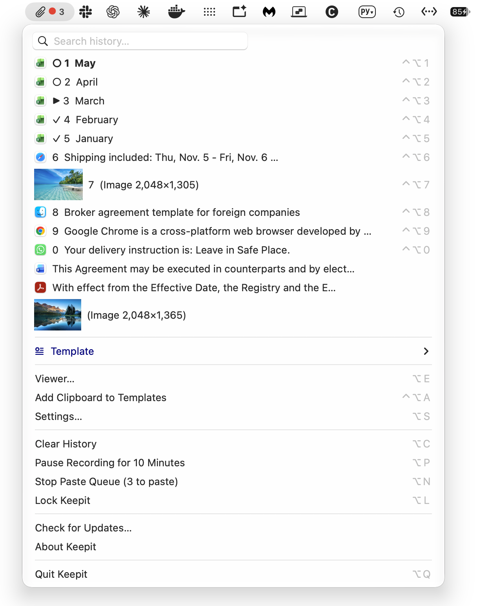

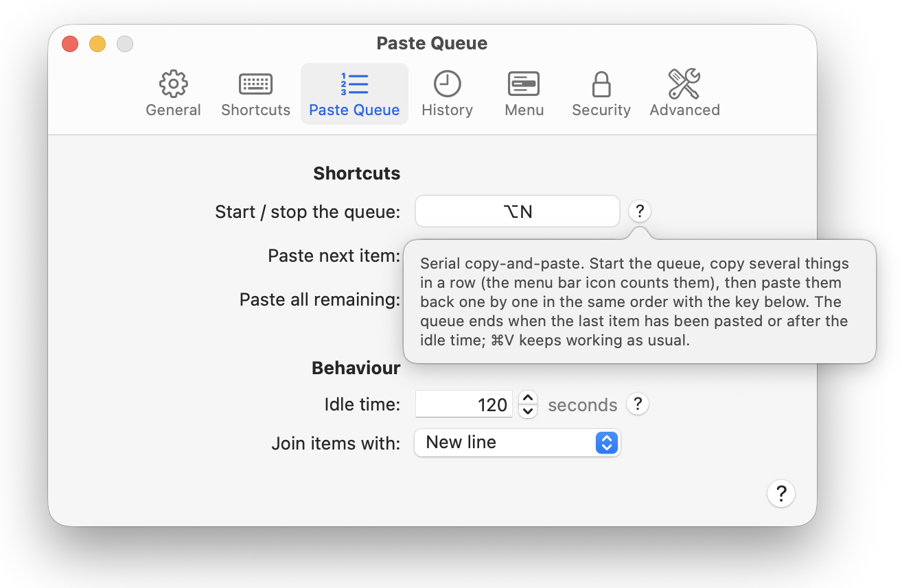

### The extended menu

Hold **⇧** while the history menu is open and every item gets a `▸` submenu with all actions for
that item: Paste, Paste as plain text, Copy only (clipboard, no paste), the *Paste as*
transformations, Add to Templates, Show in Viewer, Delete. Point at an item or press → to open it;
you can release ⇧ once it is open.


For the newest item the submenu lists the global hot keys from the table above — the same actions
with the same keys, so you can learn them here. Other items show the actions without keys: a
shortcut either works everywhere or is not shown.


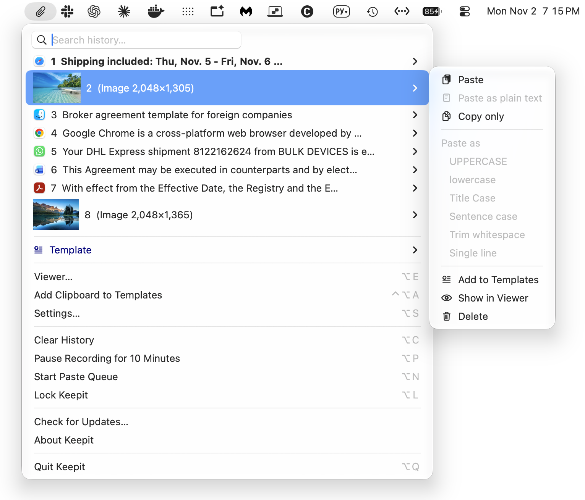

---

## Part 3 — Templates

Templates are clips you keep for good: signatures, addresses, canned replies, code snippets, a logo
you paste often. They live in a tree with folders and appear in the *Template* submenu of the history
menu and under **⌥T**. A fresh install comes with an *Examples* folder — a greeting, today's date,
a quote of the clipboard and a signature — so you can see what templates can do before you write your own;
delete or edit them as you like (*Reset…* in Settings brings them back).

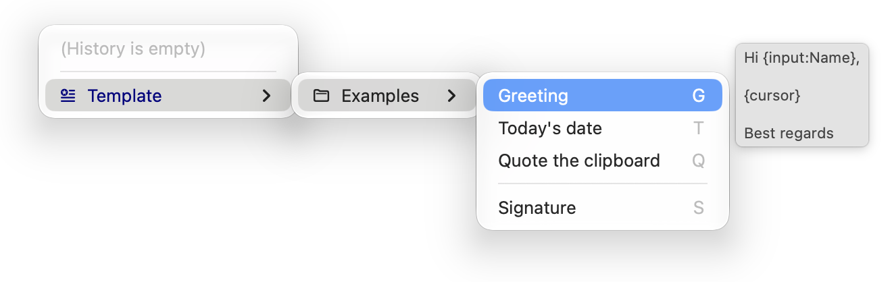


### Creating and organising

**Add a template**

- From the history menu: `⌃⌥A` for the newest item, *Add Clipboard to Templates* at the bottom, or
  ⇧ → the item's submenu → *Add to Templates* for any item.
- In the Viewer: select a history item and click *Add to Template*, or drag it onto the Template
  tree. *New Item* makes an empty text template; *New Item from File* (context menu) makes one from
  a text or image file.

**Organise**

- *New Folder* creates a folder; drag items between folders, or use *Up* / *Down* in the context
  menu.
- A template named `-` becomes a separator line in the menu.
- `&` before a letter in the name — `&Signature` — makes that letter the item's shortcut in the
  template menu: press `S` while the menu is open.
- *Set Hot Key* in the context menu gives a template its own global hot key.
- A template without a name shows its first line; *Rename* and *Clear Name* are in the context menu,
  or edit the *Name* field above the text.

### Placeholders

Text templates can contain `{…}` placeholders that are filled in at paste time. Everything else is
pasted unchanged. In the Viewer, **Insert ▾** lists every placeholder and puts the chosen one at the
cursor, so there is nothing to memorise.


The most useful ones:

| Placeholder | Result |
|-------------|--------|
| `{date}` `{time}` `{datetime}` | Today's date / current time, system format |
| `{date:yyyy-MM-dd}` | Any format (`yyyy MM dd EEEE HH mm …`) |
| `{date+7d}` `{date-1m:MMMM}` | Shifted date: `d` days, `w` weeks, `m` months, `y` years, `h` hours |
| `{clipboard}` `{clipboard:2}` | The clipboard, or history item N |
| `{clipboard\|upper}` `{clipboard\|trim\|oneline}` | Filters `upper` `lower` `title` `trim` `oneline` `url`, chainable |
| `{cursor}` | Where the text cursor ends up after pasting |
| `{user}` `{username}` `{host}` | Full name, account name, computer name |
| `{uuid}` `{random:1-100}` | A new UUID; a random number |
| `{{` `}}` | Literal braces |

The full list is in the [placeholder cheat sheet](#placeholder-cheat-sheet).

### Templates that ask questions

`{input:Name}` and `{choice:Label=A|B|C}` turn a template into a small form: when you paste it,
Keepit asks for the values first, then pastes the finished text. The same name is asked only once,
however often it appears; `{input:Name=Default}` pre-fills the field.


A reply template, for example:

```
Hi {input:Name},

thanks for your message of {date-1d}. I'll get back to you by {date+3d:EEEE}.
{cursor}
{user}
```

Pasting it asks for *Name*, fills in the dates, signs with your full name and leaves the cursor on
the empty line.

---

## Part 4 — The Viewer

*Viewer…* in the menu, or a right-click on the 📎 icon, opens a window with three trees: **Clipboard**
(the clipboard right now, read-only), **History** (*Text & files* and *Images*) and **Template**.


- Select an item to see it on the right. Text is editable in place — changes apply when you leave
  the editor; an image is shown scaled to fit the pane, its pixel size and file size above it; file
  lists open the file on double-click. *Show as Hex Dump* in the
  context menu shows the raw bytes.
- The toolbar: *Send to Clipboard*, *Paste* (into the app you came from), *Add to Template*, *New
  Item*, *New Folder*, *Delete*, *Insert ▾* (placeholders), and **?** — this guide.
- **Search** (`⌘F`): the field at the left filters history and templates by name and content and
  highlights the match.
- Drag history items into the Template tree to keep them, templates into History to copy them back;
  reorder by dragging or with *Up* / *Down*. ⌫ deletes the selected item.
- The status bar shows the date, source app, format and size.


---

## Part 5 — Settings

`⌘,` in the menu, *Settings…*, or ⌥S from any app. The window works the way settings windows do on
the Mac: pick a pane in the toolbar, and every change applies the moment you make it — there is no
Save button; close the window with ⌘W or Esc. Every option with a **?** next to it has a popover
that explains it.

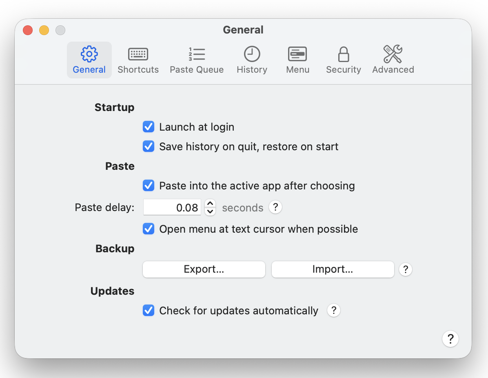

| Pane | What is there |
|-----|---------------|
| **General** | Launch at login · save history on quit, restore on start · paste after choosing (off = only copy) · paste delay — raise it for apps that are slow to come to the front · open the menu at the text cursor · Updates: *Check for updates automatically* (direct-download edition; off = no network request at all) — [Updates](#updates) |
| **Shortcuts** | Every global shortcut in one place — see below |
| **Paste Queue** | The three queue keys, the idle time after which the queue switches off, and what to put between items for *Paste all remaining* — [The paste queue](#the-paste-queue) |
| **History** | How many text/file items and images to keep (1000 / 30) · forget items older than … · *Remove duplicates* (copying the same thing again moves it to the top) · *Ignore concealed clipboard data* · the ignored-apps list (bundle identifiers; password managers are always ignored) |
| **Menu** | Search field · numbering · preview panel · tooltips · source-app icons · image thumbnails · items in menu (how many of the latest entries the menu lists, 60 by default; the rest stay searchable) · title length · thumbnail height |
| **Security** | Password, Touch ID, locking, recovery phrase — [Part 6](#part-6-security) |
| **Backup** | Automatic backup (status line beside the heading): *Back up automatically to a folder*, the Mac's name in the files, the folder, how many copies to keep · Manual backup: *Back Up Now*, *Save to Archive…* · Restore: *Restore…* — [Backup](#backup) |
| **Advanced** | Clipboard poll interval · Automation: *Allow keepit:// URL commands* (off by default — [Automation](#automation-the-keepit-url-scheme)) · Data: *Open Folder* · Reset and uninstall: *Reset…* (back to a fresh install, example templates return) · *Uninstall…* (reset, then remove the app, Launch at login, keychain entry and permissions) |

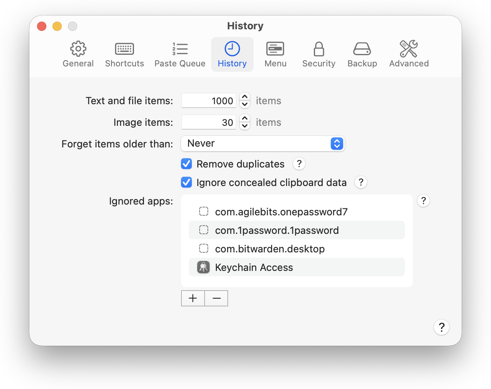


On the **Shortcuts** pane click a field and press a combination; ⌫ switches a key off; a
combination already used by another command is refused and the reason is shown under the fields; *Reset to
Defaults* brings back the ⌥-letter set (⌥M history, ⌥T templates, ⌥E Viewer, ⌥S Settings, ⌥C Clear History, ⌥P pause, ⌥L lock, ⌥Q quit), ⌥⇧V and ⌃⌥. *Paste item by number* and *Actions on the latest item*
take only modifiers — the digit or letter is added by Keepit. If macOS or another app already owns one, Keepit says so when it
starts. *Viewer* ⌥E, *Settings* ⌥S, *Clear History* ⌥C, *Pause recording* ⌥P, *Lock Keepit* ⌥L and *Quit Keepit* ⌥Q work from any app and are shown next to their commands in the menu. On a US layout ⌥+letter normally types a special character (⌥S = ß, ⌥C = ç …); if you need one of those, move the key.

---

## Part 6 — Security

### Password and encryption

*Settings → Security → Require password at launch* encrypts the history and templates with
AES-256-GCM. The key is derived from your password (PBKDF2, 200 000 rounds) and lives only in
memory; it is wiped when Keepit locks — *Lock Keepit* (`⌥L`), on quit, and optionally after
the Mac has been locked or asleep for a while. *Lock when the Mac is locked or asleep* is **Never**
by default: a clipboard manager that asks for its password after every coffee break stops being used,
and `⌥L` is there for the moments that matter. *Immediately* locks with the screen; *After 5 minutes*,
*15 minutes* or *1 hour* leave a short absence alone — Keepit stays unlocked and keeps recording — and
lock only when the Mac has been away for the whole time. With Touch ID on, Keepit asks for a touch
the moment the Mac is unlocked, so it is ready before the first `⌥M`.

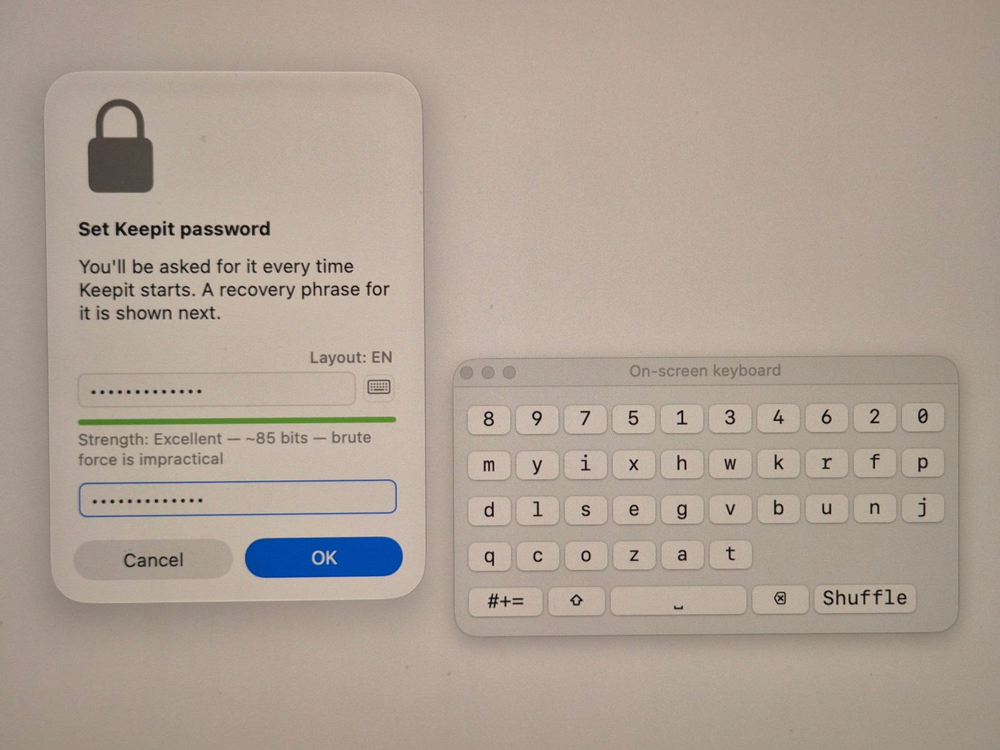

The password dialogs show the current keyboard layout and warn about Caps Lock, so a rejected
password is rarely a mystery. The keyboard button next to the field opens an **on-screen keyboard**
for typing the password with the mouse: the clicks never pass through the system as key presses, its
keys are shuffled every time it opens, and it asks macOS to keep it out of screenshots and screen
recording (on some configurations it is excluded; this is not guaranteed) — for a Mac you do not
fully trust, or one that is being screen-shared. At launch, and after a lock, Keepit asks for the password (or Touch ID);
*Recovery Access…* takes the 24-word phrase instead — see [Recovery phrase](#recovery-phrase).

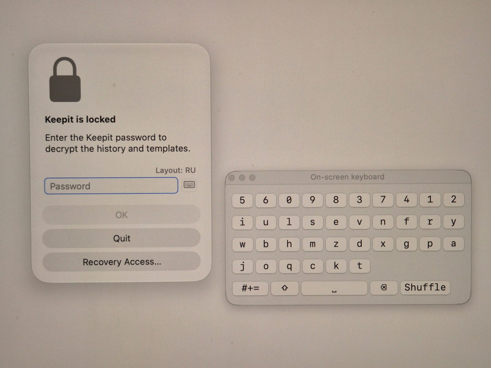


### Touch ID

With *Unlock with Touch ID* the key is also stored in the Secure Enclave behind your fingerprint:
Keepit asks for a touch instead of the password. The password keeps working as a fallback — *Use
Password* on the prompt. With the lid closed and an external Magic Keyboard with Touch ID, Keepit
asks on the keyboard. *Allow changing the password with Touch ID* lets a fingerprint stand in for
the old password when you change it.


### Recovery phrase

When you set a password Keepit shows a 24-word phrase once. Print it or keep it in a password
manager. If you forget the password, *Recovery Access…* on the unlock dialog opens the data and
lets you set a new one. *Recovery phrase → Create New…* issues a fresh phrase and invalidates the old.

Without the password, Touch ID on the same Mac, or the phrase, the data cannot be recovered: there
is no server and nothing to reset.


### Backup

Keepit can keep an encrypted copy of your history and templates in a folder of your choice — iCloud
Drive, Dropbox, Google Drive, an external disk, a NAS — and write a new one whenever something has
changed. There is no Keepit server: the folder is yours. What the provider behind it can see is the
encrypted file, its size and a small unencrypted header (when and by which Keepit it was written,
how the key is derived, random identifiers — and your Mac's name only if you switch that on); the
[security page](/security#backups) lists it field by field.

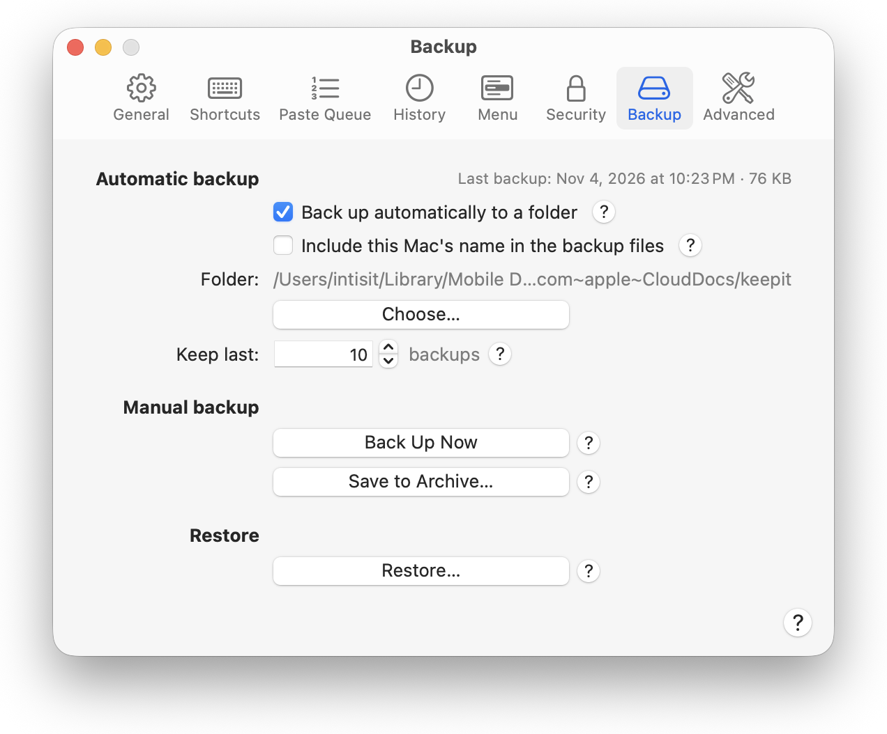

**Switching it on.** *Settings → Backup → Back up automatically to a folder*, then
*Choose…* a folder (the chooser opens in iCloud Drive). Automatic backup needs the password
protection from *Settings → Security*: each copy is sealed with a key derived from your vault's key,
so it opens with your Keepit password — or your recovery phrase — on this Mac or any other, and
nothing has to be set up for it. Without a password the checkbox is disabled and says so.

**What happens then — the schedule.** About five minutes after the last change (and at the latest once a day while
Keepit runs) Keepit writes a file named `Keepit-<date and time>-<installation>-<id>.keepit` into the
folder, reads it back to check it, and only then deletes the oldest of its own copies beyond *Keep
last* (10 by default, 1–100). Each copy is complete on its own — not an increment — so one file is
all you ever need. Copies made by another Mac, or files you put there yourself, are never touched:
two Macs sharing a folder write two independent series. The status line beside the *Automatic
backup* heading shows the last copy's time and size, or why the last attempt failed. Nothing
happens while Keepit is locked; *Back Up Now* (under *Manual backup*) does not wait for the quiet period.

**Include this Mac's name** (off by default) puts the computer's name into the unencrypted header
of each file, so two series in one folder are easy to tell apart in the Finder. The storage provider
can see that name; that is why it is optional.

**Restore.** *Restore…* opens a backup — one of this Mac's, another Mac's, or an exported file —
after you unlock it: with the password of the Mac it was made on, or with the recovery phrase that
Mac showed when its password was set (*Recovery Access…* in the password dialog). A preview shows
when and where the file was made and how many items it holds, then:

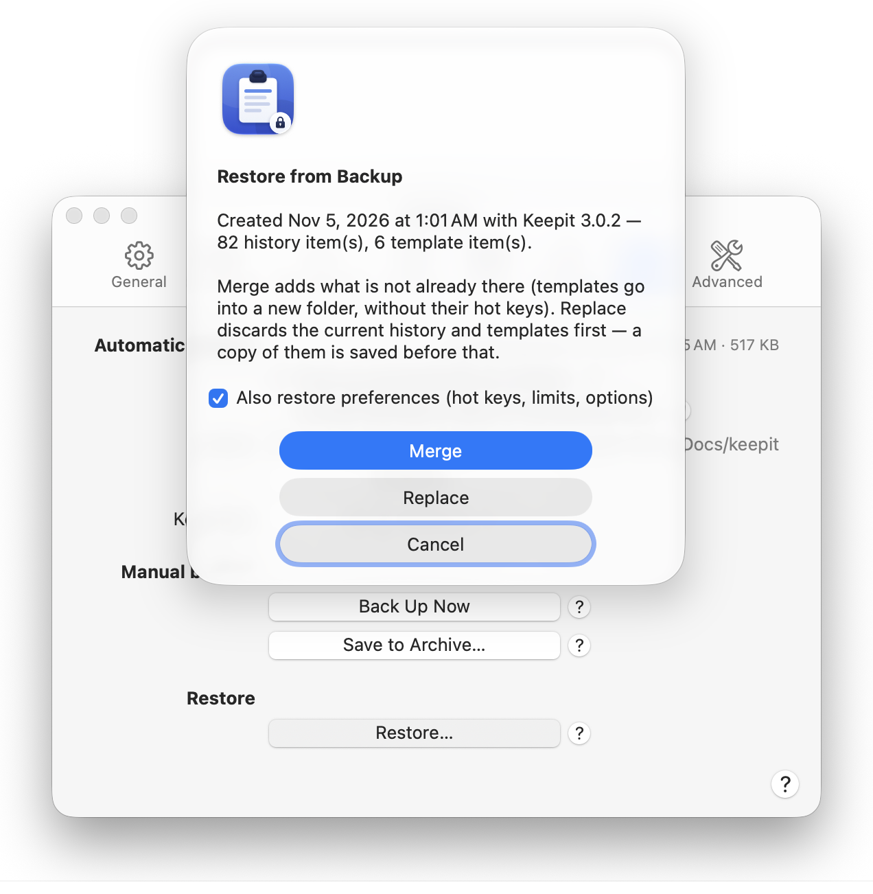

- *Merge* adds what is not already there — history items by content, and the backup's templates as
  one new folder named *Imported <date>*, without their hot keys — so you can see exactly what came
  from the backup and move or delete it. Nothing of yours is overwritten.
- *Replace* discards the current history and templates and takes the backup's instead. Before it
  does, Keepit writes a copy of what you have now (`Keepit-before-restore-…`) into the backup
  folder, or into a folder you pick; if that copy cannot be written, Replace does not start. If
  Keepit has no password yet, you are asked for one for that copy, as with *Save to Archive…*.

*Also restore preferences* brings the hot keys, limits and options from the backup; the settings
that express trust in a particular Mac — Touch ID, URL automation and its trusted apps, the backup
folder itself — always stay as they are here. If the backup's history is larger than this Mac's
limits allow, Keepit says how much would fit before you confirm.

Restored a backup with its recovery phrase on a Mac that has no password yet? Keepit asks you to set
one first, so the restored data never lands unencrypted, and lets you keep that phrase for this Mac
or get a new one. Restored with the password? Keepit offers to keep it as this Mac's password. In
both cases automatic backup itself is a per-Mac setting: switch it on here and choose the folder —
the same one is fine — and this Mac starts its own series of files next to the old Mac's.

**Moving to a new Mac** is the whole point: install Keepit, choose *Restore from Backup…* on the
first launch, pick the newest file in your folder, enter the old Mac's password, *Replace*; then
switch automatic backup on for the new Mac. Copies made so far open with the password and phrase
that were in force when each was written — after a password change, the old ones still need the old
password.

**Manual backup.** Two buttons, two different things. *Back Up Now* makes an automatic-style copy
right away — same kind of file, same folder and series, opened with your Keepit password or
phrase. *Save to Archive…* writes one `.keepit` *archive* wherever you choose, locked with a
password you pick for it: it does not need Keepit's password protection, and Keepit does not keep
track of the file afterwards — for handing data over, or for a copy outside the backup folder.
Its suggested name says what it is: `Keepit-archive-<date>-manual.keepit`, next to the automatic
copies' `Keepit-<date and time>-<installation>-<id>.keepit`.

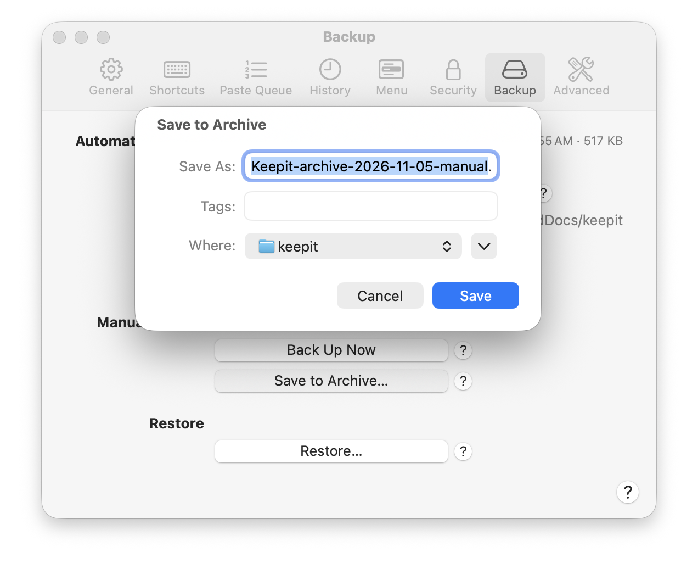

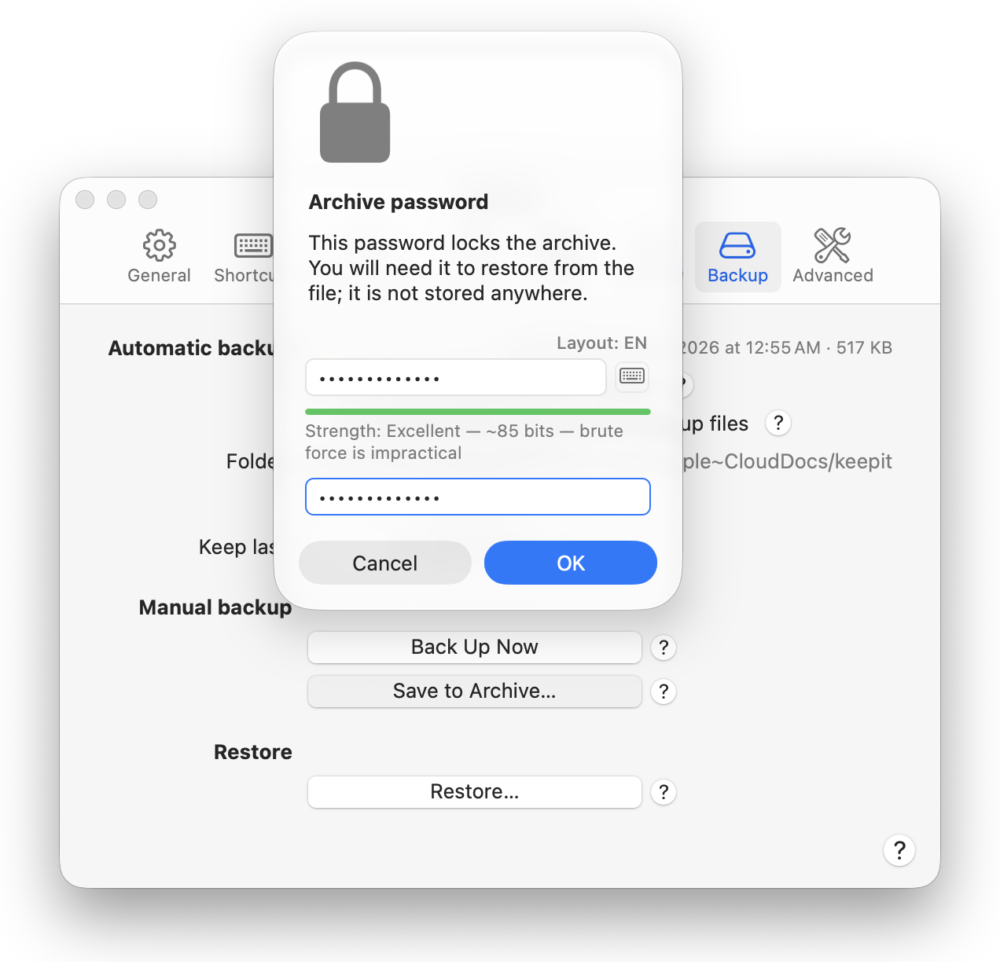

*Restore…* opens either. The archive replaces *Export…* / *Import…* of 2.x; the file moves data
between the direct download and the App Store edition, and between Keepit 2.x and 3.x — a file
written by 3.0 needs 3.0 or newer to open; 3.0 reads everything 2.x wrote.

**If something goes wrong.** A failed copy is reported in the status line and retried with growing
pauses; the previous copies stay. If Keepit was quit or the Mac went down in the middle of a
restore, the next launch quietly puts everything back as it was before the restore; in the rare
case that it cannot (a file it cannot write, a full disk), it names the file and quits without
changing anything — fix the file, launch again. Details, including what the file format looks like
inside, are on the [security page](/security#backups).

---

## Part 7 — Advanced

### Automation: the keepit:// URL scheme

Shortcuts (*Open URL*), Raycast, Alfred, Keyboard Maestro or `open` in a shell can drive Keepit —
**once you turn it on** in *Settings → Advanced → Automation → Allow keepit:// URL commands*. It is
off by default because any app or web page can open a URL, and `add` / `paste` change the clipboard
and type into the front app; with it off, Keepit ignores such URLs with a beep. With it on, Keepit
looks at who opened the URL: the first command that changes something (`paste`, `copy`, `template`,
`add`, `add-template`, `pause`, `resume`) from each app is shown in a dialog — *Allow* runs it once,
*Always Allow* puts the app on the trusted list (cleared with *Forget Trusted Apps* on the same
pane). A web browser, or a sender macOS cannot name, is asked every time. Commands that only open
Keepit's own windows never ask.

| URL | Effect |
|-----|--------|
| `keepit://paste/2`<br>`keepit://paste/latest`<br>`keepit://paste/previous` | Paste history item N (or the latest / the previous one) into the front app |
| `keepit://copy/3` | Put item N on the clipboard without pasting |
| `keepit://template/Signature`<br>`keepit://template/Work/Reply?copy=1` | Paste (or copy) a template by name or folder path |
| `keepit://add?text=…` | Add text to the history and the clipboard |
| `keepit://add-template?text=…&name=…` | Create a template |
| `keepit://history`<br>`keepit://templates`<br>`keepit://viewer`<br>`keepit://settings` | Open the history menu, the template menu, the Viewer, Settings |
| `keepit://pause`<br>`keepit://resume` | Pause recording for 10 minutes / resume |

Percent-encode the text (`%20` for a space). URLs are ignored while Keepit is locked.

### Updates

Keepit checks GitHub Releases once a day and offers updates in a dialog; *Check for Updates…* does it
now. Updates are signed (EdDSA) and notarized. With Homebrew, `brew upgrade --cask keepit` does the
same. Checksums for every download are in `SHA256SUMS` on the release page.

The check is the only network request Keepit makes, and it is optional: *Settings → General →
Updates → Check for updates automatically*. Switched off, Keepit never contacts anything — not even
when you ask — and *Check for Updates…* disappears from the menus; you then update by downloading
from [keep.it.com](https://keep.it.com) or with Homebrew. The App Store edition has no updater and
no such option; the App Store updates it.

### Uninstalling

*Settings → Advanced → Reset and uninstall → Uninstall…* removes the app, the data folder, the keychain
entries (including the Touch ID key), the login item and the Accessibility entry. It asks for your
password or Touch ID, a typed `DELETE` and a confirmation — export a backup first if you might want
the data back. With Homebrew, run `brew uninstall --cask --force keepit` afterwards so Homebrew
forgets the cask.

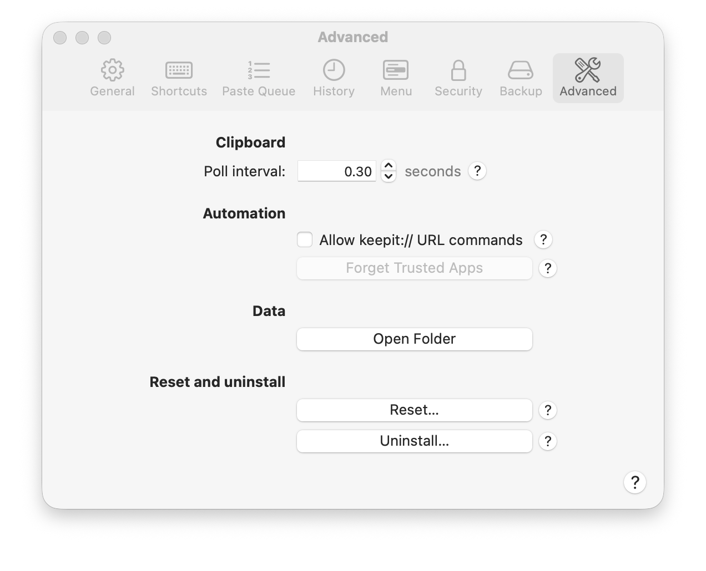

---

## Reference

### Troubleshooting

**Nothing is pasted after choosing an item.** Accessibility is missing: *System Settings → Privacy &
Security → Accessibility → Keepit*. If Keepit is listed but still does not paste, switch it off and
on again — macOS forgets the grant when the app is reinstalled.

**A hot key does nothing.** Another app or macOS owns it; Keepit reports that at launch. Pick a
different combination on the *Shortcuts* pane. ⌃⌥ with digits and letters is free on a stock Mac.

**The menu opens in the wrong place.** The app you are in does not expose its text cursor, so the
menu falls back to the mouse pointer. *Open menu at text cursor* on the General tab turns the
lookup off if you prefer the pointer always.

**Something I copied is missing.** Anything marked concealed by the copying app is not recorded,
and neither is a copy made while a password manager (built-in list) or an app on your ignore list
was in front — including the app you switched away from a moment ago. See *Settings → History*
and the [security page](/security#what-is-not-recorded).

**Touch ID is not offered.** No Touch ID sensor is reachable at the moment (lid closed, no Touch ID
keyboard). Keepit keeps the setting and asks for the fingerprint as soon as a sensor is available.

**The backup status says the folder is not available.** The folder was moved, renamed, unmounted
or (iCloud Drive) evicted. Mount or restore it and the next copy goes through; or *Choose…* a new
folder — a new folder starts a new series, the old files stay where they are.

**A backup file will not open.** *Wrong password* means the file's authentication tag did not
match: make sure you are using the password of the Mac that *wrote* the file (after a password
change, old copies still open with the old password), or its recovery phrase. *This backup needs
Keepit 3.0 or newer* means the file was written by a newer version than the one opening it.

**Homebrew refuses to install over an existing app.** Quit Keepit and move
`/Applications/Keepit.app` to the Trash first, or add `--force`.

Still stuck? [GitHub Issues](https://github.com/andrey-insarov/Keepit/issues) · admin@keep.it.com

### Keyboard cheat sheet

| Keys | Action |
|------|--------|
| `⌥M` | History menu — type to search |
| `⌥T` | Template menu |
| `⌃⌥1` … `⌃⌥0` | Paste item 1–10 (in the menu and anywhere) |
| `⇧` in the menu | Extended menu: all actions per item |
| `⌥⇧V` | Paste the previous item / swap |
| `⌃⌥V` | Paste the clipboard as plain text |
| `⌃⌥U` `⌃⌥L` `⌃⌥T` `⌃⌥S` | UPPERCASE / lowercase / Title Case / Sentence case |
| `⌃⌥W` `⌃⌥J` | Trimmed / single line |
| `⌃⌥A` | Add the clipboard to Templates |
| `⌃⌥⌫` | Delete the newest item |
| `⌥N` · `⌥V` · `⌥⇧N` | Paste queue: start / stop · paste next · paste all remaining |
| `⌥E` `⌥S` `⌥C` `⌥P` `⌥L` `⌥Q` | Viewer · Settings · Clear History · Pause recording · Lock · Quit |
| `⌘F` in the Viewer | Search |
| `⌘,` | Settings |

### Placeholder cheat sheet

| Placeholder | Result |
|-------------|--------|
| `{date}` `{time}` `{datetime}` | Date / time / both, system format |
| `{date:yyyy-MM-dd}` `{time:HH:mm}` | Custom format (Unicode date patterns) |
| `{date+7d}` `{date-1m:MMMM}` | Shifted date: `d` `w` `m` `y` `h` |
| `{weekday}` `{month}` `{year}` | Day name, month name, year |
| `{iso}` `{unix}` | ISO 8601 timestamp, Unix time |
| `{clipboard}` `{clipboard:2}` | The clipboard (item 1) or item N |
| `{clipboard\|upper}` `\|lower` `\|title` `\|trim` `\|oneline` `\|url` | Filters, chainable |
| `{input:Name}` `{input:Name=Default}` | Ask for a value before pasting |
| `{choice:Label=A\|B\|C}` | Ask to pick an option |
| `{cursor}` | Caret position after pasting |
| `{user}` `{username}` `{host}` | Full name, account name, computer name |
| `{uuid}` `{random:1-100}` | New UUID, random number in a range |
| `{{` `}}` | Literal braces |
