# Keepit user guide

Keepit is a clipboard history and template manager for macOS. It lives in the menu bar, remembers
everything you copy, and pastes any of it back with a hot key. All shortcuts below are the defaults;
each can be changed in *Preferences → Hot keys*.

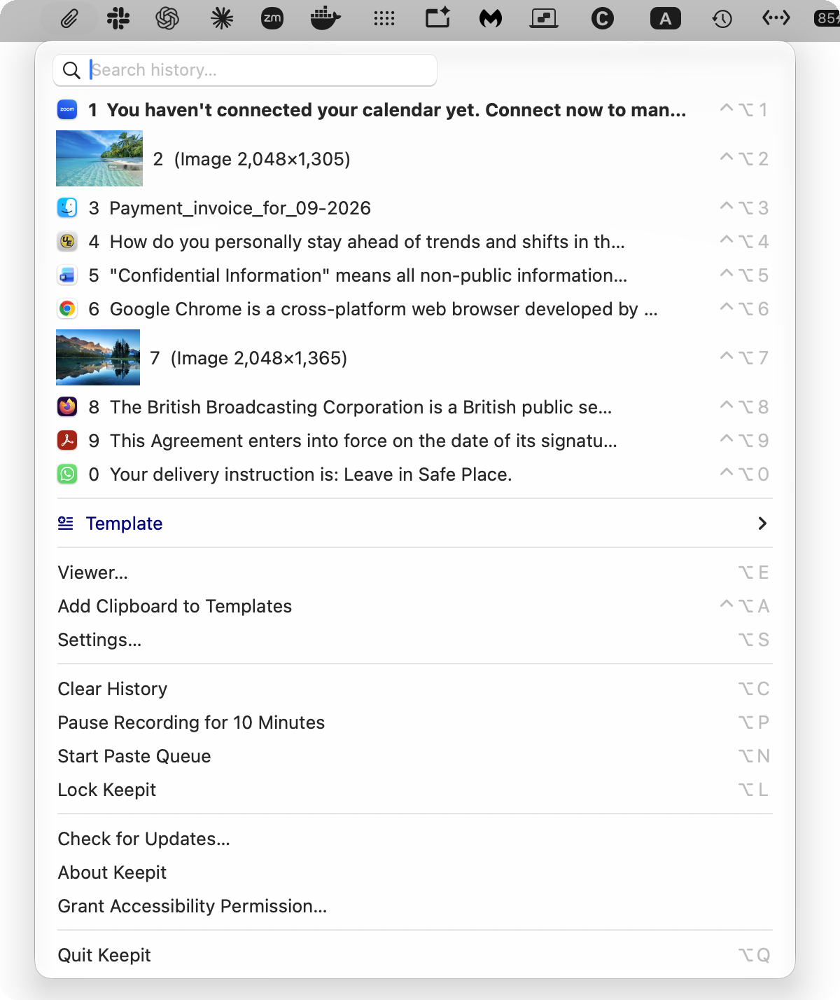

**Contents**

- [Part 1 — Getting started](#part-1--getting-started): [Install](#install) · [First launch](#first-launch)
- [Part 2 — Everyday use](#part-2--everyday-use): [The history menu](#the-history-menu) · [Search and preview](#search-and-preview) · [Paste without the menu](#paste-without-the-menu) · [The paste queue](#the-paste-queue) · [The extended menu](#the-extended-menu)
- [Part 3 — Templates](#part-3--templates): [Creating and organising](#creating-and-organising) · [Placeholders](#placeholders) · [Templates that ask questions](#templates-that-ask-questions)
- [Part 4 — The Viewer](#part-4--the-viewer)
- [Part 5 — Preferences](#part-5--preferences)
- [Part 6 — Security](#part-6--security): [Password and encryption](#password-and-encryption) · [Touch ID](#touch-id) · [Recovery phrase](#recovery-phrase) · [Backup](#backup)
- [Part 7 — Advanced](#part-7--advanced): [Automation](#automation-the-keepit-url-scheme) · [Updates](#updates) · [Uninstalling](#uninstalling)
- [Reference](#reference): [Troubleshooting](#troubleshooting) · [Keyboard cheat sheet](#keyboard-cheat-sheet) · [Placeholder cheat sheet](#placeholder-cheat-sheet)

---

## Part 1 — Getting started

### Install

**Homebrew** — recommended, because `brew upgrade` keeps it current:

```bash
brew tap andrey-insarov/keepit https://github.com/andrey-insarov/Keepit
brew install --cask andrey-insarov/keepit/keepit
```

**DMG** — download `Keepit-<version>.dmg` from the
[latest release](https://github.com/andrey-insarov/Keepit/releases/latest), open it and drag Keepit
into *Applications*.

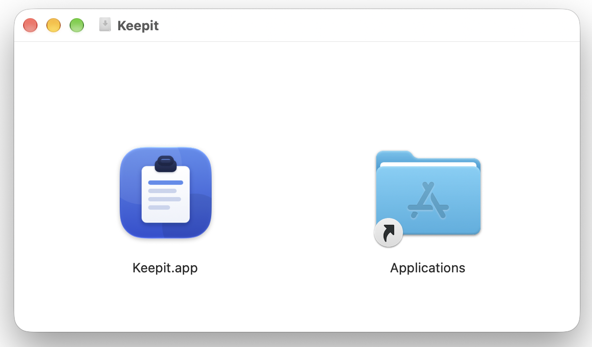

The first time you open the app, macOS confirms that it came from the Internet and was checked by
Apple. Click *Open*.

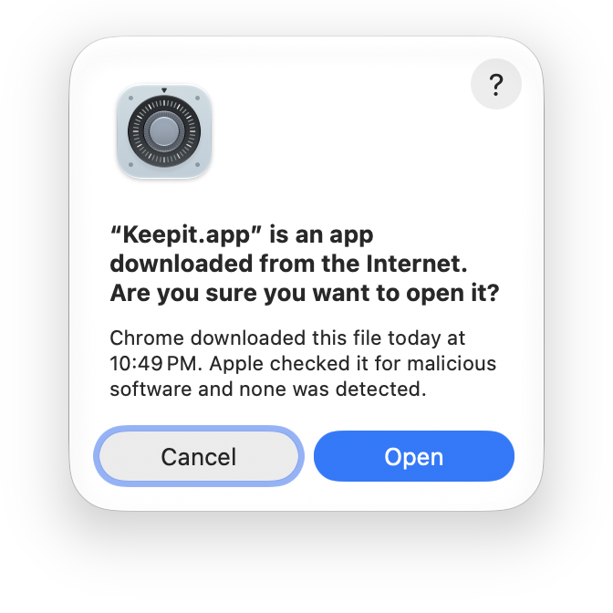

Keepit is signed and notarized, updates itself, and runs natively on Apple silicon and Intel Macs
with macOS 13 Ventura or newer.

### First launch

Keepit is a menu-bar app: no Dock icon, no window until you open one. After the first launch the 📎
icon appears in the menu bar, and Keepit asks two things.

**1. The Accessibility permission.** To paste for you, Keepit sends ⌘V to the app you were working
in; macOS allows that only for apps listed under *System Settings → Privacy & Security →
Accessibility*. Click *Open System Settings* and switch Keepit on. Without it Keepit still records
and copies, but you press ⌘V yourself.

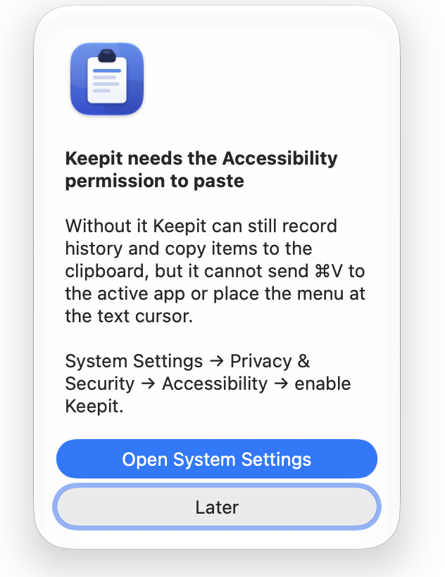

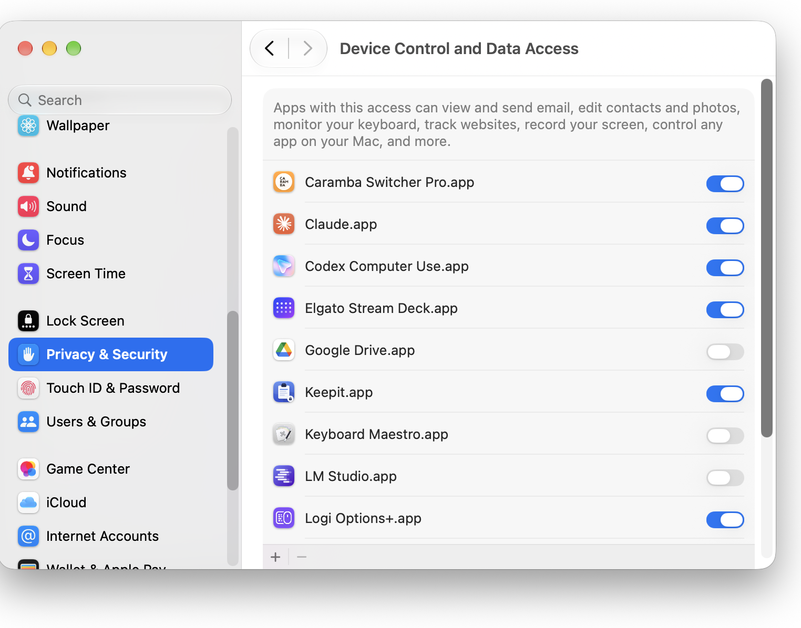

**2. A password (optional).** Keepit can store the history and templates encrypted and unlock with
Touch ID. You can decide now or later in *Preferences → Security*; [Part 6](#part-6--security)
explains how it works. *Not Now* keeps everything unencrypted on disk.

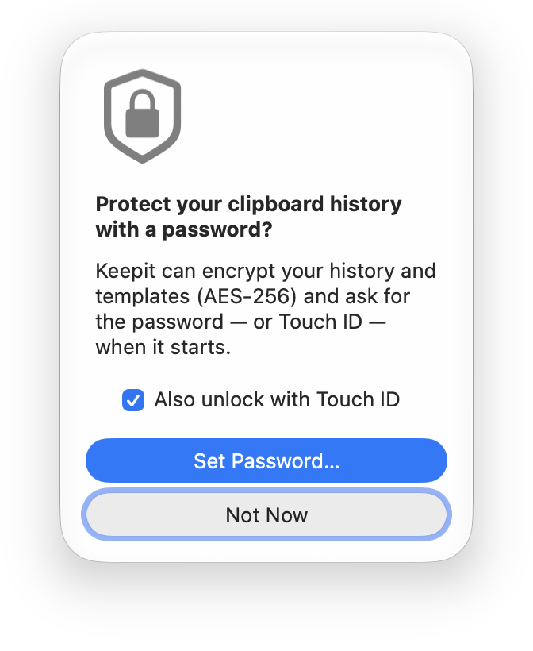

Keepit starts at login by default — *Preferences → General* switches that off.

---

## Part 2 — Everyday use

### The history menu

Press **⌥M** in any app, or click the 📎 icon. The menu opens at your text cursor when Keepit can
find it, otherwise at the mouse pointer.

Each line is one clip, newest first. The newest one is **bold** — it is what is on the clipboard
right now. The icon shows the app you copied from; a title ending in `…` has more lines than the
menu shows. Images show a thumbnail, file lists show the file names.

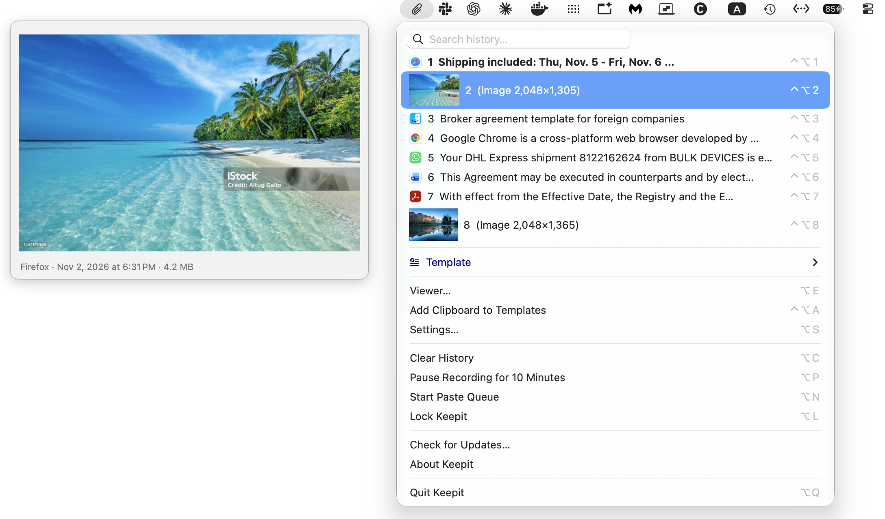

To paste an item: click it, or move to it with ↑ ↓ and press Return, or press its number with
**⌃⌥** — `⌃⌥3` pastes item 3. The same key works from anywhere, without opening the menu.

Below the history: the *Template* submenu, the Viewer (⌥E), Preferences (⌥S), *Clear History* (⌥C),
*Pause Recording for 10 Minutes* (⌥P — for typing something you do not want recorded), *Lock Keepit*
(⌥L) when a password is set, and the updater. **⌥T** opens the template menu on its own; every one
of these keys also works without the menu.

### Search and preview

**Search.** Start typing while the menu is open: the field at the top filters the list by title and
by full text, so a line in the middle of a long clip is found too. Return pastes the first match;
Esc clears the field, and a second Esc closes the menu.

**Preview.** Hover over an item (or move to it with the keyboard) and a panel beside the menu shows
the full image, or the first lines of a long text, with the source app, date and size. Short
one-line texts have no preview — the menu line already shows them whole.

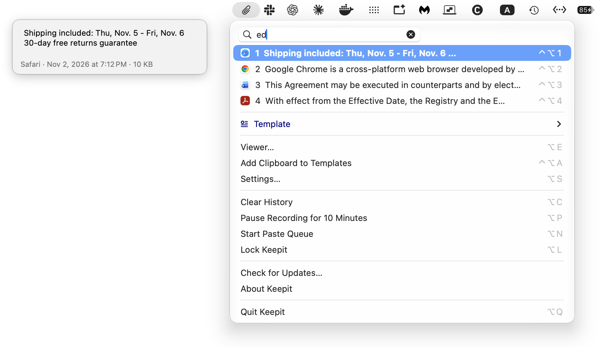

### Paste without the menu

Global hot keys act on the history as it is right now — item 1 is the clipboard — from any app:

| Keys | What happens |
|------|--------------|
| `⌃⌥1` … `⌃⌥9`, `⌃⌥0` | Paste history item 1–10 |
| `⌥⇧V` | Paste the *previous* item (item 2); press again to swap back |
| `⌃⌥V` | Paste the clipboard as plain text, formatting stripped |
| `⌃⌥U` `⌃⌥L` `⌃⌥T` `⌃⌥S` | Paste the clipboard as UPPERCASE / lowercase / Title Case / Sentence case |
| `⌃⌥W` | Paste the clipboard trimmed of leading and trailing whitespace |
| `⌃⌥J` | Paste the clipboard joined into one line |
| `⌃⌥A` | Add the clipboard to Templates |
| `⌃⌥⌫` | Delete the newest item from the history |

Transformations apply to text; for an image or a file list the key beeps. All of these can be
changed or switched off in *Preferences → Hot keys*.

### The paste queue

Sometimes you want to copy five things from one place and paste them, in order, somewhere else —
cells into a form, lines from a page into a document. The paste queue does that without the menu:

1. Press **⌥R** (or *Start Paste Queue* in the menu). The menu bar icon shows a red dot and a
   counter: `📎 ● 0`.
2. Copy as usual with ⌘C, as many times as you like. The counter goes up with every copy: 1, 2, 3…
   Everything is recorded in the history too.
3. Switch to where the text goes and press **⌥V** for each item. The first thing you copied is
   pasted first, the counter goes down. ⌘V still pastes the clipboard as usual, so you can mix both.
4. The queue switches itself off after the last item is pasted, or after two minutes without a copy
   or a paste (the time is adjustable). ⌥R again stops it early.

**⌥⇧R** pastes everything still in the queue in one go, items joined with a line break, a tab, a
space or nothing — pick on the *Paste queue* tab of Preferences, where the idle time lives too. While the queue is on, the history menu marks its
items: `▶` next to paste, `○` still queued, `✓` already pasted.

### The extended menu

Hold **⇧** while the history menu is open and every item gets a `▸` submenu with all actions for
that item: Paste, Paste as plain text, Copy only (clipboard, no paste), the *Paste as*
transformations, Add to Templates, Show in Viewer, Delete. Point at an item or press → to open it;
you can release ⇧ once it is open.

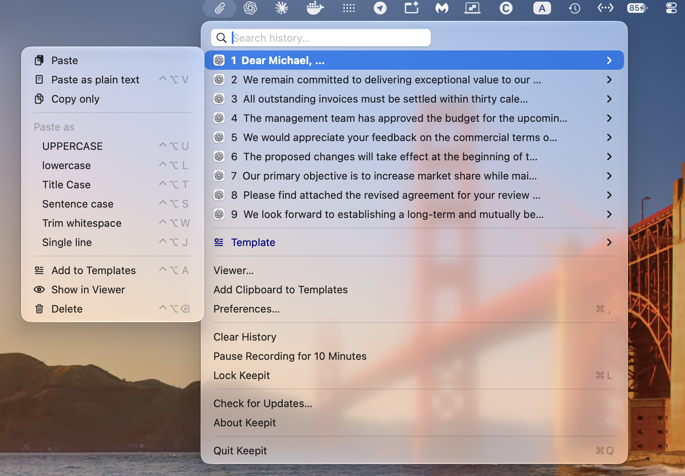

For the newest item the submenu lists the global hot keys from the table above — the same actions
with the same keys, so you can learn them here. Other items show the actions without keys: a
shortcut either works everywhere or is not shown.

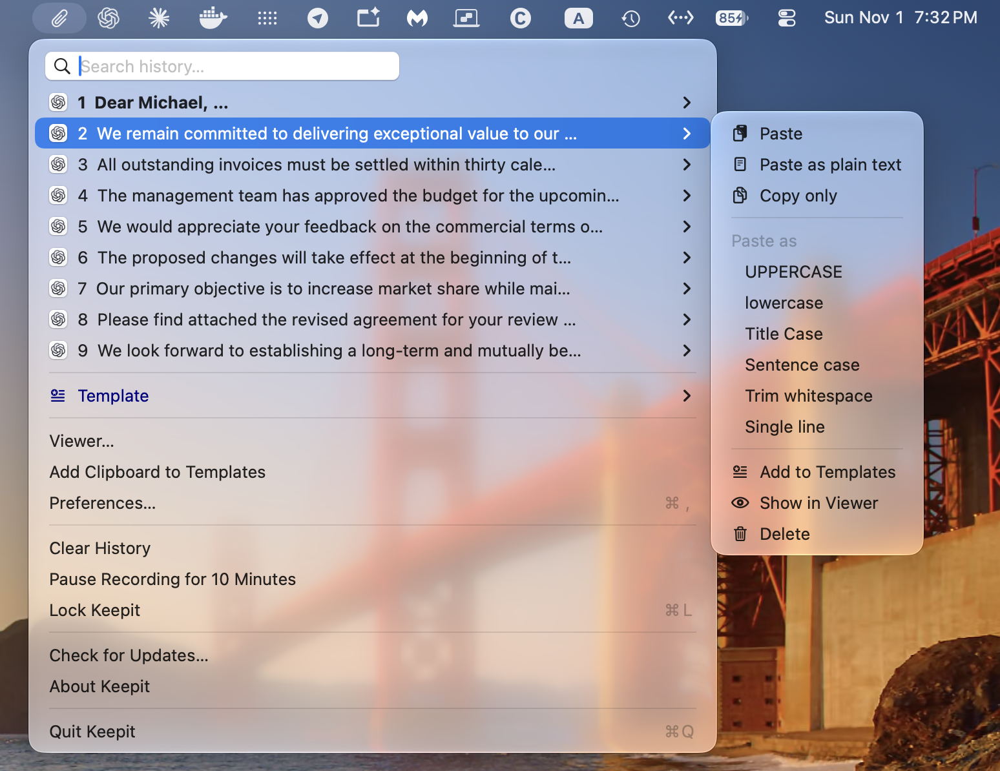

---

## Part 3 — Templates

Templates are clips you keep for good: signatures, addresses, canned replies, code snippets, a logo
you paste often. They live in a tree with folders and appear in the *Template* submenu of the history
menu and under **⌥T**.

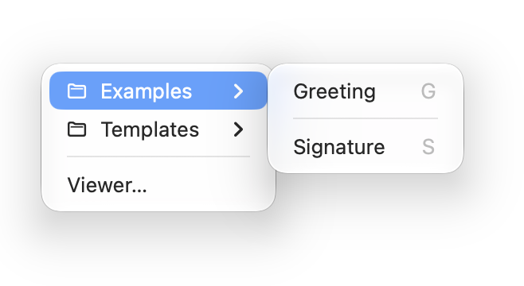

### Creating and organising

**Add a template**

- From the history menu: `⌃⌥A` for the newest item, *Add Clipboard to Templates* at the bottom, or
  ⇧ → the item's submenu → *Add to Templates* for any item.
- In the Viewer: select a history item and click *Add to Template*, or drag it onto the Template
  tree. *New Item* makes an empty text template; *New Item from File* (context menu) makes one from
  a text or image file.

**Organise**

- *New Folder* creates a folder; drag items between folders, or use *Up* / *Down* in the context
  menu.
- A template named `-` becomes a separator line in the menu.
- `&` before a letter in the name — `&Signature` — makes that letter the item's shortcut in the
  template menu: press `S` while the menu is open.
- *Set Hot Key* in the context menu gives a template its own global hot key.
- A template without a name shows its first line; *Rename* and *Clear Name* are in the context menu,
  or edit the *Name* field above the text.

### Placeholders

Text templates can contain `{…}` placeholders that are filled in at paste time. Everything else is
pasted unchanged. In the Viewer, **Insert ▾** lists every placeholder and puts the chosen one at the
cursor, so there is nothing to memorise.

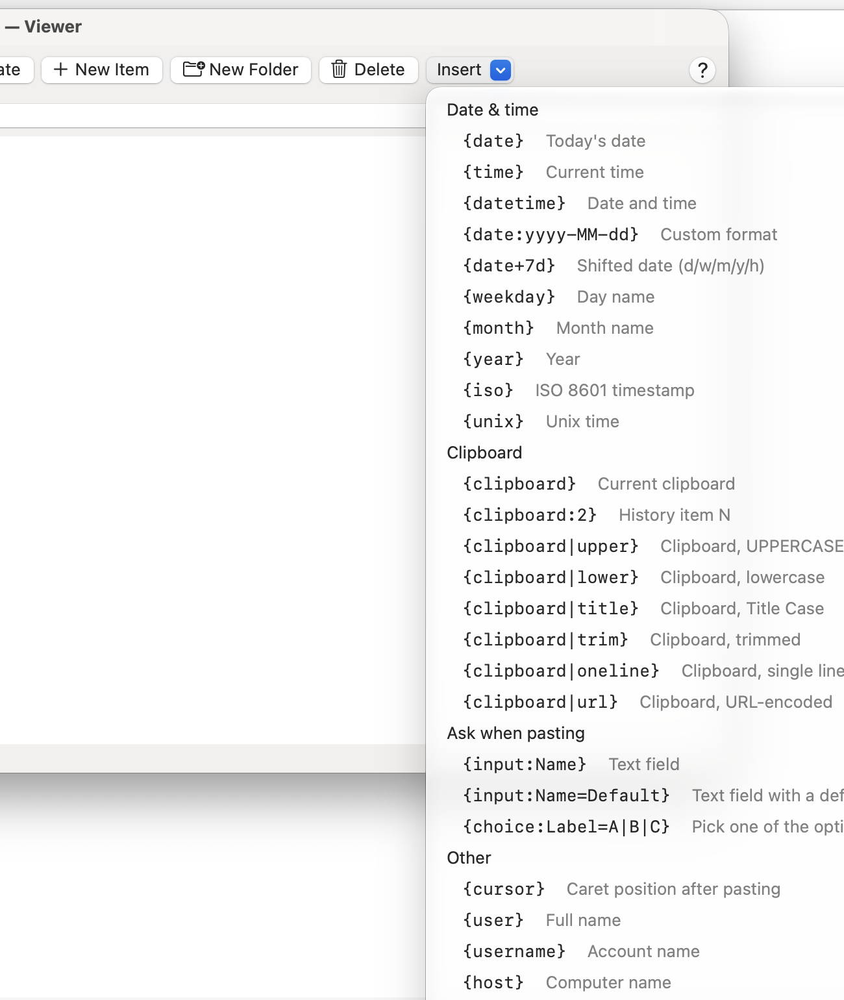

The most useful ones:

| Placeholder | Result |
|-------------|--------|
| `{date}` `{time}` `{datetime}` | Today's date / current time, system format |
| `{date:yyyy-MM-dd}` | Any format (`yyyy MM dd EEEE HH mm …`) |
| `{date+7d}` `{date-1m:MMMM}` | Shifted date: `d` days, `w` weeks, `m` months, `y` years, `h` hours |
| `{clipboard}` `{clipboard:2}` | The clipboard, or history item N |
| `{clipboard\|upper}` `{clipboard\|trim\|oneline}` | Filters `upper` `lower` `title` `trim` `oneline` `url`, chainable |
| `{cursor}` | Where the text cursor ends up after pasting |
| `{user}` `{username}` `{host}` | Full name, account name, computer name |
| `{uuid}` `{random:1-100}` | A new UUID; a random number |
| `{{` `}}` | Literal braces |

The full list is in the [placeholder cheat sheet](#placeholder-cheat-sheet).

### Templates that ask questions

`{input:Name}` and `{choice:Label=A|B|C}` turn a template into a small form: when you paste it,
Keepit asks for the values first, then pastes the finished text. The same name is asked only once,
however often it appears; `{input:Name=Default}` pre-fills the field.

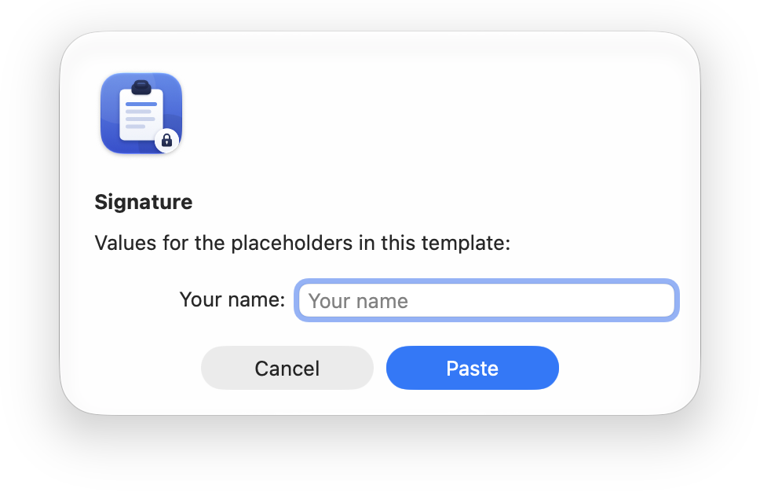

A reply template, for example:

```
Hi {input:Name},

thanks for your message of {date-1d}. I'll get back to you by {date+3d:EEEE}.
{cursor}
{user}
```

Pasting it asks for *Name*, fills in the dates, signs with your full name and leaves the cursor on
the empty line.

---

## Part 4 — The Viewer

*Viewer…* in the menu, or a right-click on the 📎 icon, opens a window with three trees: **Clipboard**
(the clipboard right now, read-only), **History** (*Text & files* and *Images*) and **Template**.

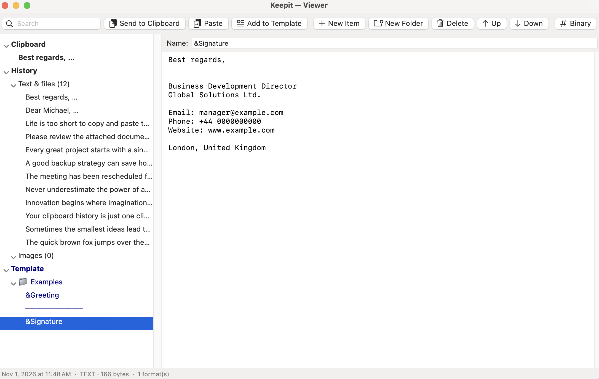

- Select an item to see it on the right. Text is editable in place — changes apply when you leave
  the editor; images are shown; file lists open the file on double-click. *Show as Hex Dump* in the
  context menu shows the raw bytes.
- The toolbar: *Send to Clipboard*, *Paste* (into the app you came from), *Add to Template*, *New
  Item*, *New Folder*, *Delete*, *Insert ▾* (placeholders), and **?** — this guide.
- **Search** (`⌘F`): the field at the left filters history and templates by name and content and
  highlights the match.
- Drag history items into the Template tree to keep them, templates into History to copy them back;
  reorder by dragging or with *Up* / *Down*. ⌫ deletes the selected item.
- The status bar shows the date, source app, format and size.

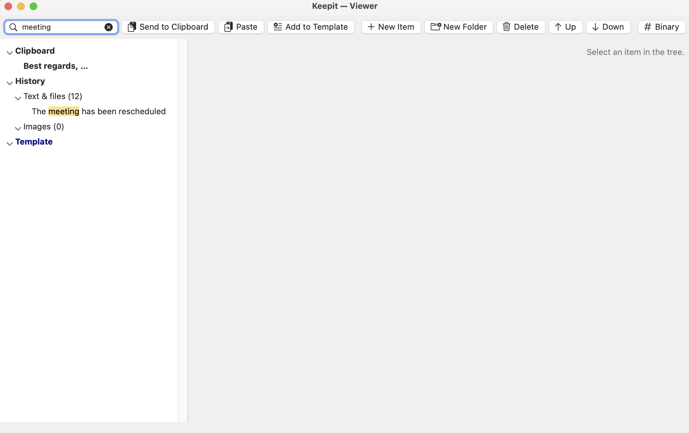

---

## Part 5 — Preferences

`⌘,` in the menu, or *Preferences…*. Every option with a **?** next to it has a popover that explains
it.

| Tab | What is there |
|-----|---------------|
| **General** | Launch at login · save history on quit, restore on start · paste after choosing (off = only copy) · paste delay — raise it for apps that are slow to come to the front · open the menu at the text cursor |
| **Hot keys** | Every global shortcut in one place — see below |
| **Paste queue** | The three queue keys, the idle time after which the queue switches off, and what to put between items for *Paste all remaining* — [The paste queue](#the-paste-queue) |
| **History** | How many text/file items and images to keep (1000 / 30) · forget items older than … · *Remove duplicates* (copying the same thing again moves it to the top) · *Ignore concealed clipboard data* · the ignored-apps list (bundle identifiers; password managers are always ignored) |
| **Menu** | Search field · numbering · preview panel · tooltips · source-app icons · image thumbnails · title length · thumbnail height |
| **Security** | Password, Touch ID, locking, recovery phrase, Export / Import Backup — [Part 6](#part-6--security) |
| **Advanced** | Clipboard poll interval · *Open Data Folder* · Danger zone: *Delete Keepit and All Data…* |

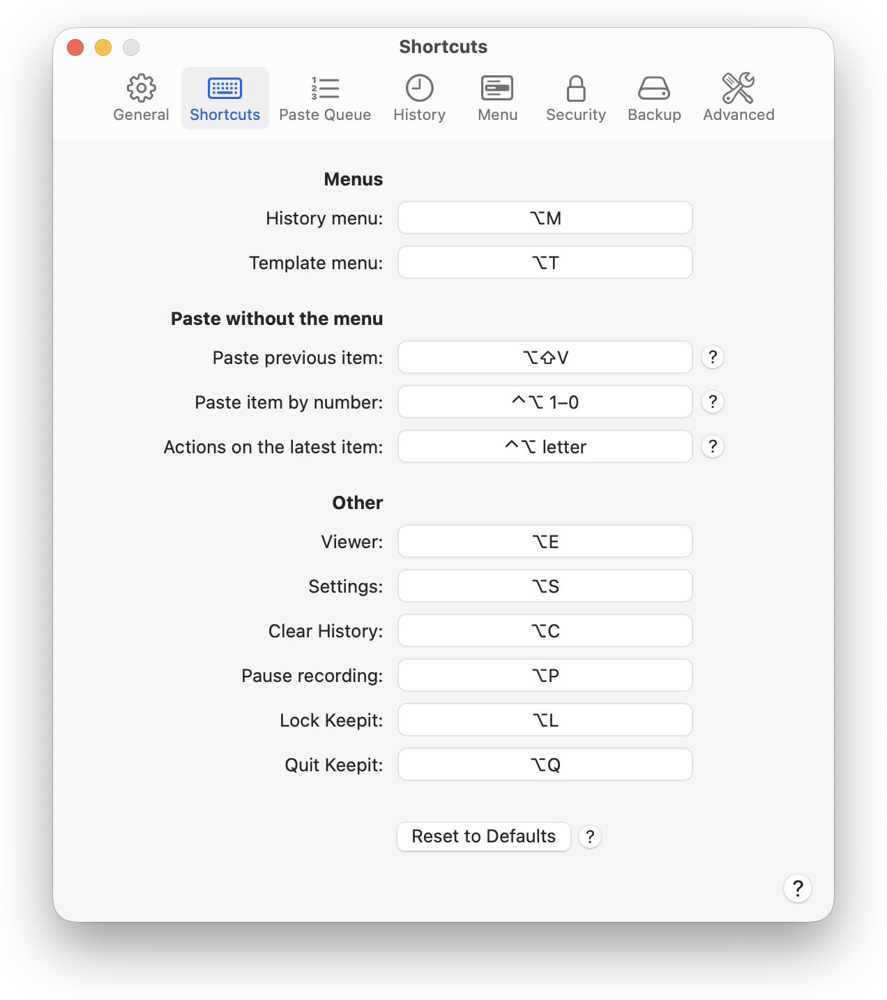

On the **Hot keys** tab click a field and press a combination; ⌫ switches a key off; *Reset to
Defaults* brings back the ⌥-letter set (⌥M history, ⌥T templates, ⌥E Viewer, ⌥S Preferences, ⌥C Clear History, ⌥P pause, ⌥L lock, ⌥Q quit), ⌥⇧V and ⌃⌥. *Paste item by number* and *Actions on the latest item*
take only modifiers — the digit or letter is added by Keepit. Two of your own keys on the same
combination are refused on Save; if macOS or another app already owns one, Keepit says so when it
starts. *Viewer* ⌥E, *Preferences* ⌥S, *Clear History* ⌥C, *Pause / resume recording* ⌥P, *Lock Keepit* ⌥L and *Quit Keepit* ⌥Q work from any app and are shown next to their commands in the menu. On a US layout ⌥+letter normally types a special character (⌥S = ß, ⌥C = ç …); if you need one of those, move the key.

---

## Part 6 — Security

### Password and encryption

*Preferences → Security → Require password at launch* encrypts the history and templates with
AES-256-GCM. The key is derived from your password (PBKDF2, 200 000 rounds) and lives only in
memory; it is wiped when Keepit locks — *Lock Keepit* (`⌥L`), on quit, and optionally
when the screen locks or the Mac sleeps.

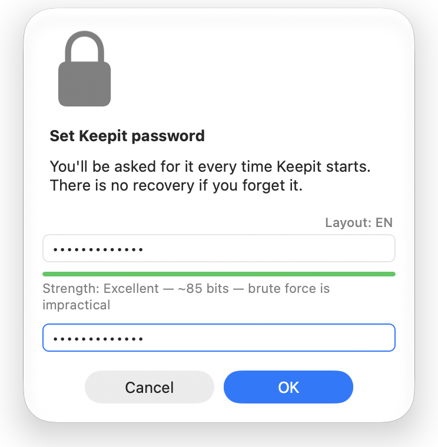

The password dialogs show the current keyboard layout and warn about Caps Lock, so a rejected
password is rarely a mystery.

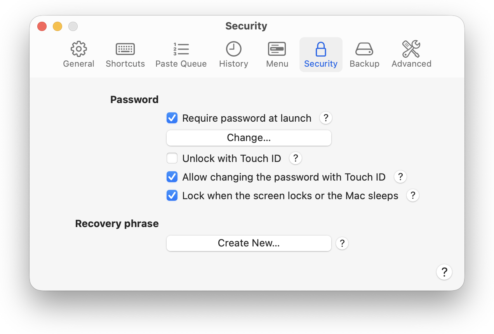

### Touch ID

With *Unlock with Touch ID* the key is also stored in the Secure Enclave behind your fingerprint:
Keepit asks for a touch instead of the password. The password keeps working as a fallback — *Use
Password* on the prompt. With the lid closed and an external Magic Keyboard with Touch ID, Keepit
asks on the keyboard. *Allow changing the password with Touch ID* lets a fingerprint stand in for
the old password when you change it.

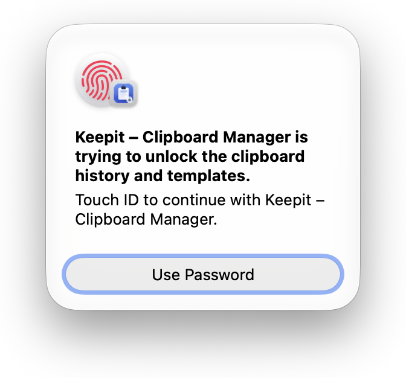

### Recovery phrase

When you set a password Keepit shows a 24-word phrase once. Print it or keep it in a password
manager. If you forget the password, *Use Recovery Phrase…* on the unlock dialog opens the data and
lets you set a new one. *New Recovery Phrase…* issues a fresh phrase and invalidates the old.

Without the password, Touch ID on the same Mac, or the phrase, the data cannot be recovered: there
is no server and nothing to reset.

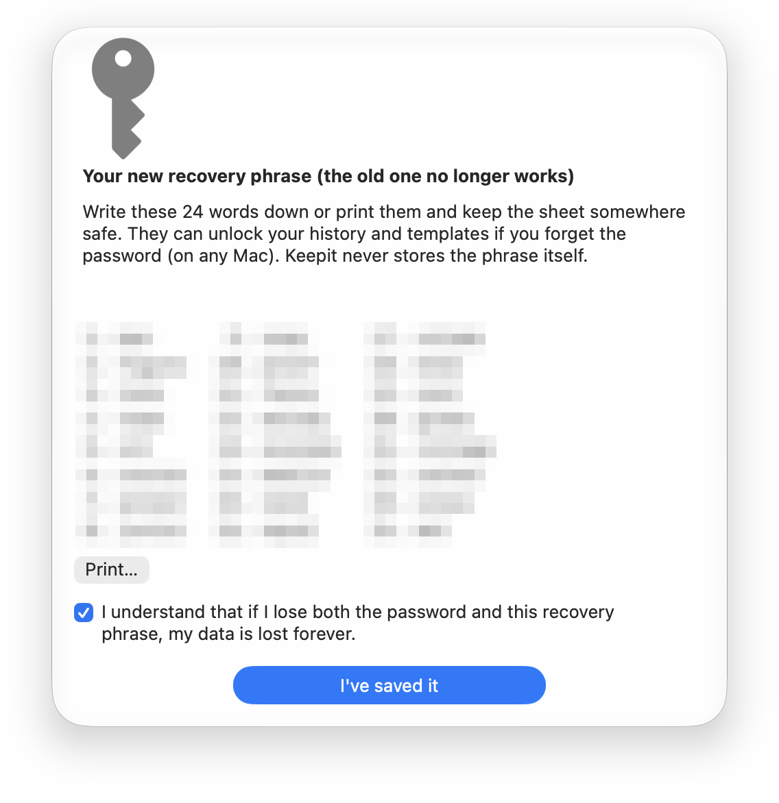

### Backup

*Export Backup…* writes one `.keepit` file with the history, templates and preferences, encrypted
with a password you choose for the file. *Import Backup…* reads it back on any Mac — *Merge* adds to
what is there, *Replace* starts from the backup. The same file moves data between the direct
download and the App Store edition.

---

## Part 7 — Advanced

### Automation: the keepit:// URL scheme

Shortcuts (*Open URL*), Raycast, Alfred, Keyboard Maestro or `open` in a shell can drive Keepit:

| URL | Effect |
|-----|--------|
| `keepit://paste/2`, `keepit://paste/latest`, `keepit://paste/previous` | Paste history item N into the front app |
| `keepit://copy/3` | Put item N on the clipboard without pasting |
| `keepit://template/Signature`, `keepit://template/Work/Reply?copy=1` | Paste (or copy) a template by name or folder path |
| `keepit://add?text=…` | Add text to the history and the clipboard |
| `keepit://add-template?text=…&name=…` | Create a template |
| `keepit://history` `keepit://templates` `keepit://viewer` `keepit://preferences` | Open the menus and windows |
| `keepit://pause` `keepit://resume` | Pause recording for 10 minutes / resume |

Percent-encode the text (`%20` for a space). URLs are ignored while Keepit is locked.

### Updates

Keepit checks GitHub Releases once a day and offers updates in a dialog; *Check for Updates…* does it
now. Updates are signed (EdDSA) and notarized. With Homebrew, `brew upgrade --cask keepit` does the
same. Checksums for every download are in `SHA256SUMS` on the release page.

### Uninstalling

*Preferences → Advanced → Delete Keepit and All Data…* removes the app, the data folder, the keychain
entries (including the Touch ID key), the login item and the Accessibility entry. It asks for your
password or Touch ID, a typed `DELETE` and a confirmation — export a backup first if you might want
the data back. With Homebrew, run `brew uninstall --cask --force keepit` afterwards so Homebrew
forgets the cask.

---

## Reference

### Troubleshooting

**Nothing is pasted after choosing an item.** Accessibility is missing: *System Settings → Privacy &
Security → Accessibility → Keepit*. If Keepit is listed but still does not paste, switch it off and
on again — macOS forgets the grant when the app is reinstalled.

**A hot key does nothing.** Another app or macOS owns it; Keepit reports that at launch. Pick a
different combination on the *Hot keys* tab. ⌃⌥ with digits and letters is free on a stock Mac.

**The menu opens in the wrong place.** The app you are in does not expose its text cursor, so the
menu falls back to the mouse pointer. *Open menu at text cursor* on the General tab turns the
lookup off if you prefer the pointer always.

**Something I copied is missing.** Copies from password managers and anything marked concealed are
never recorded; apps on the ignore list are skipped. See *Preferences → History*.

**Touch ID is not offered.** No Touch ID sensor is reachable at the moment (lid closed, no Touch ID
keyboard). Keepit keeps the setting and asks for the fingerprint as soon as a sensor is available.

**Homebrew refuses to install over an existing app.** Quit Keepit and move
`/Applications/Keepit.app` to the Trash first, or add `--force`.

Still stuck? [GitHub Issues](https://github.com/andrey-insarov/Keepit/issues) · dp@intistele.com

### Keyboard cheat sheet

| Keys | Action |
|------|--------|
| `⌥M` | History menu — type to search |
| `⌥T` | Template menu |
| `⌃⌥1` … `⌃⌥0` | Paste item 1–10 (in the menu and anywhere) |
| `⇧` in the menu | Extended menu: all actions per item |
| `⌥⇧V` | Paste the previous item / swap |
| `⌃⌥V` | Paste the clipboard as plain text |
| `⌃⌥U` `⌃⌥L` `⌃⌥T` `⌃⌥S` | UPPERCASE / lowercase / Title Case / Sentence case |
| `⌃⌥W` `⌃⌥J` | Trimmed / single line |
| `⌃⌥A` | Add the clipboard to Templates |
| `⌃⌥⌫` | Delete the newest item |
| `⌥R` · `⌥V` · `⌥⇧R` | Paste queue: start / stop · paste next · paste all remaining |
| `⌥E` `⌥S` `⌥C` `⌥P` `⌥L` `⌥Q` | Viewer · Preferences · Clear History · Pause / resume · Lock · Quit |
| `⌘F` in the Viewer | Search |
| `⌘,` | Preferences |

### Placeholder cheat sheet

| Placeholder | Result |
|-------------|--------|
| `{date}` `{time}` `{datetime}` | Date / time / both, system format |
| `{date:yyyy-MM-dd}` `{time:HH:mm}` | Custom format (Unicode date patterns) |
| `{date+7d}` `{date-1m:MMMM}` | Shifted date: `d` `w` `m` `y` `h` |
| `{weekday}` `{month}` `{year}` | Day name, month name, year |
| `{iso}` `{unix}` | ISO 8601 timestamp, Unix time |
| `{clipboard}` `{clipboard:2}` | The clipboard (item 1) or item N |
| `{clipboard\|upper}` `\|lower` `\|title` `\|trim` `\|oneline` `\|url` | Filters, chainable |
| `{input:Name}` `{input:Name=Default}` | Ask for a value before pasting |
| `{choice:Label=A\|B\|C}` | Ask to pick an option |
| `{cursor}` | Caret position after pasting |
| `{user}` `{username}` `{host}` | Full name, account name, computer name |
| `{uuid}` `{random:1-100}` | New UUID, random number in a range |
| `{{` `}}` | Literal braces |
