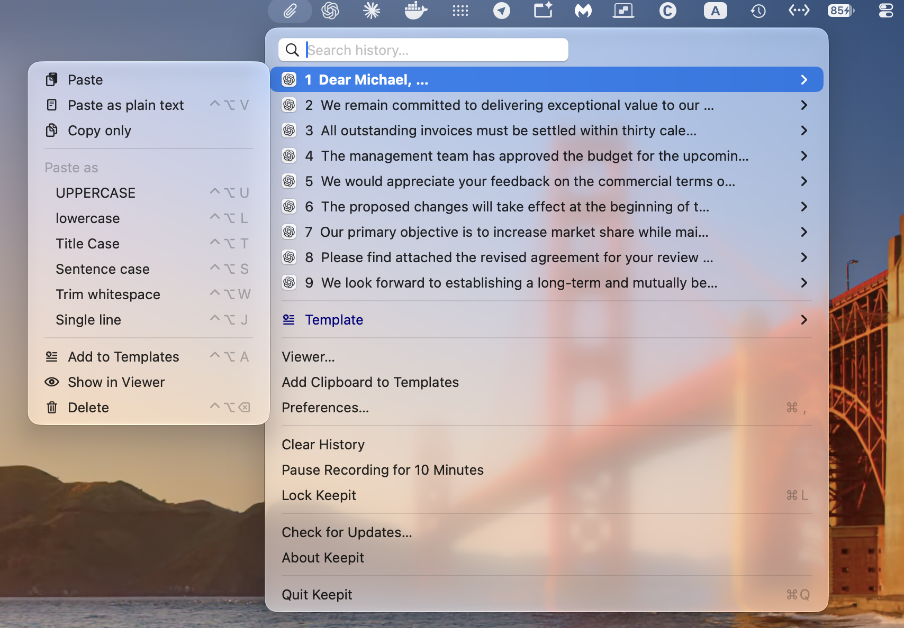

# How to paste as plain text on a Mac

Copy a sentence from a web page or a document and paste it into an email, and the font, size and colour come along with it. Pasting as plain text drops that formatting so the text takes on the style of wherever you paste it. macOS can do this in most apps; a clipboard manager can do it everywhere, with one key.

## The built-in shortcut: Paste and Match Style

In most Mac apps, *Edit → Paste and Match Style* pastes the clipboard without its formatting. The shortcut is **`⌥⇧⌘V`** (Option-Shift-Command-V). It works in Mail, Notes, Pages, Safari, Messages, TextEdit and most third-party apps.

Where it does not work:

- Some apps use a different key. Microsoft Word has *Paste Special*; Google Docs in a browser uses `⇧⌘V`.
- Some apps have no plain-text paste at all, and some editors paste the formatting regardless.
- Four keys with one hand is awkward, and it is easy to hit `⇧⌘V` instead, which does something else in many apps.

### Make ⌘V always paste plain text in one app

You can remap the shortcut per app in *System Settings → Keyboard → Keyboard Shortcuts → App Shortcuts*: add the app, enter the exact menu title *Paste and Match Style* and assign `⌘V`. It only applies to apps whose menu has that exact item, and you have to repeat it for every app.

## Paste plain text anywhere with one key

[Keepit](index.html), a free clipboard manager for Mac, adds a global plain-text paste that works the same in every app:

- **`⌃⌥V`** pastes the current clipboard as plain text, formatting stripped. It is a global hot key, so it works in apps that have no *Paste and Match Style* of their own.
- In the history menu (`⌥M`), **`⌘` + number** pastes that item as plain text, and holding `⇧` gives every item a submenu with *Paste as Plain Text* and the other transformations.
- The same family of keys transforms text on the way out: `⌃⌥U` pastes as UPPERCASE, `⌃⌥L` lowercase, `⌃⌥T` Title Case, `⌃⌥S` Sentence case, `⌃⌥W` trimmed of surrounding whitespace, `⌃⌥J` joined onto one line.

Every key can be changed in *Preferences → Hot keys*, and if you want plain text to be the default, set a per-app paste key in *Preferences → Menu* for the apps that need it.

Keepit is open source and keeps everything on your Mac; the [security page](security.html) explains what is stored and how.

## Related

- [How to see your clipboard history on a Mac](clipboard-history-mac.html)
- [How to clear the clipboard on a Mac](clear-clipboard-mac.html)
- [The user guide](guide.html)
