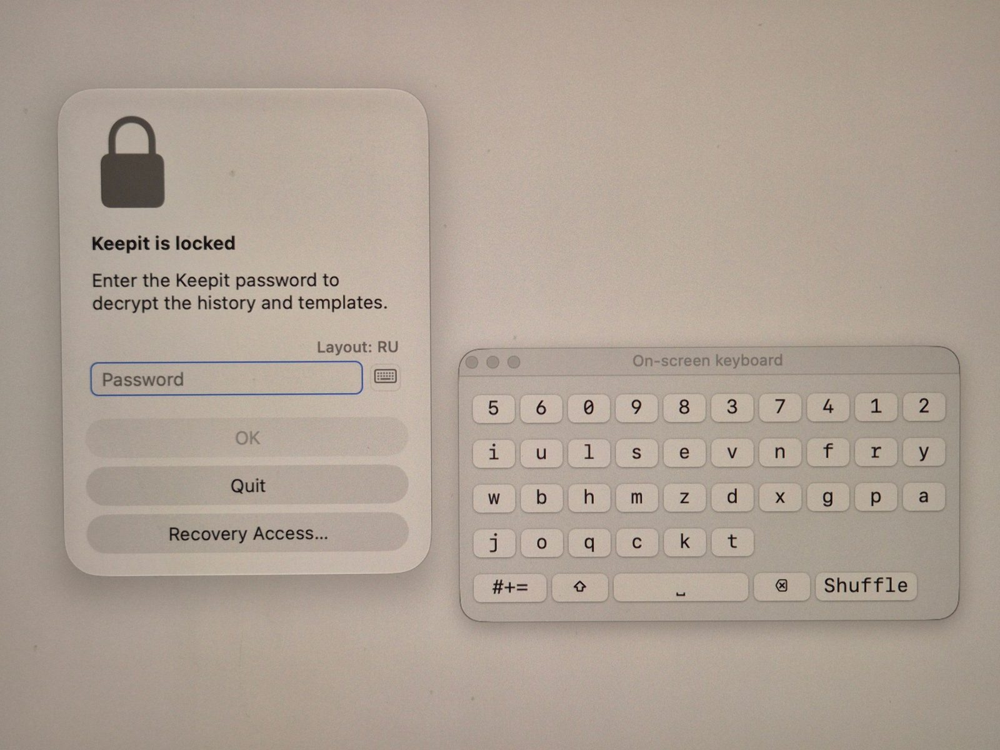

# Keepit security

A clipboard manager sees everything you copy, so it has to be clear about what it keeps, where, and
who can get at it. This page is the complete picture for Keepit. The code is open
([github.com/andrey-insarov/Keepit](https://github.com/andrey-insarov/Keepit)), so every claim here
can be checked against it.

## In one paragraph

Keepit stores your clipboard history and templates in one folder on your Mac and nowhere else — plus,
if you switch it on, encrypted copies in a folder *you* choose (iCloud Drive, Dropbox, a disk); the
provider behind that folder sees the ciphertext, the file size and a short unencrypted header
(listed below), nothing of the content. There is no account, no Keepit cloud, no analytics, and the
app makes exactly one kind of network request — the daily update check against GitHub — which you
can switch off. Clipboard data that the copying app marks as concealed is not
recorded, and copies from known password managers are excluded by app — a best-effort heuristic,
explained below. If you set a password, everything on disk is AES-256-GCM encrypted with a key derived from that password; the key
exists only in memory, is wiped when Keepit locks, and can optionally be released by Touch ID from
the Secure Enclave. A 24-word recovery phrase is the only way back in if you forget the password —
Keepit itself cannot reset it.

## What is stored, and where

Everything lives in `~/Library/Application Support/Keepit/` (App Store edition: the app's container
under `~/Library/Containers/com.it.keep/`):

| File | Contents | Encrypted with a password? |
|------|----------|----------------------------|
| `history.json` | The clipboard history: text, RTF, HTML, PNG images, file lists, with date and source app | Yes |
| `templates.json` | The template tree, including per-template hot keys | Yes |
| `settings.json` | Settings: hot keys, limits, ignore list — no clipboard data | No |
| `vault.json` | Encryption metadata: KDF name and round count, PBKDF2 salt, a sealed verifier, the wrapped recovery material | — |

The history is written when it changes and read on launch. Without a password the JSON is plain
text on disk, protected only by your macOS account and FileVault. *Settings → Advanced → Open
Data Folder* shows the folder.

Keepit also writes to the macOS keychain — only the Touch ID entry described below — and registers
itself as a login item if you let it start at login.

## What is not recorded

Three layers, in decreasing order of certainty. It matters which one you are relying on.

1. **Marked by the source — reliable.** Anything the copying app marks as concealed or transient
   (`org.nspasteboard.ConcealedType`, `org.nspasteboard.TransientType`, 1Password's own type) is
   skipped on the strength of the mark alone; Keepit does not need to know which app wrote it.
   1Password, Bitwarden, Apple Passwords, Keychain Access and many terminals set these marks. (The
   check can be turned off on *Settings → History*; leave it on.)
2. **Known by app — best effort.** Copies from a password manager that sets no mark are excluded by
   its bundle identifier: KeePassXC, MacPass, Strongbox, KeeWeb, LastPass, Dashlane, Enpass, Keeper,
   NordPass, RoboForm (and, as a second line, the apps in layer 1) are built in and always active;
   add your own apps on *Settings → History*. The limit here is macOS: the pasteboard does not record
   which app wrote it, so Keepit works from which apps were in front since it last looked (every
   300 ms by default). If any of them is on the list, the change is skipped — including when you copy
   and switch to another app before Keepit notices. This errs towards skipping. It cannot cover a
   copy made by a background process or a script, and it cannot tell a password from any other text
   in an app that is not on the list.
3. **By your choice.** Anything copied while recording is paused (*Pause Recording for 10 Minutes*,
   `⌥P`), apps on your ignore list, and formats other than plain text, RTF, HTML, PNG and file lists.

Keepit does not inspect text for things that look like passwords or one-time codes. If an app that
is not on the list puts a secret on the clipboard without marking it, it is recorded like anything
else: use the pause or the ignore list for such apps, and delete the item from the history.

## Encryption

Turn on *Require password at launch* and the history and templates files are encrypted:

- **Key derivation**: PBKDF2-HMAC-SHA256 with 200 000 rounds and a random 16-byte salt, producing a
  256-bit key. The salt, the KDF name and the round count are stored in `vault.json` (so the
  parameters can change in a later version without breaking existing vaults); nothing else derived
  from the password is written except a small GCM-sealed verifier that lets Keepit tell a wrong
  password from corrupt data.
- **Cipher**: AES-256-GCM (CryptoKit), a fresh random nonce per file write, authenticated — a
  modified file fails to open rather than decrypting to garbage.
- **Key in memory**: the 32 key bytes live in a dedicated buffer that is overwritten with `memset_s`
  when Keepit locks or quits; Keepit asks the kernel to keep that page out of swap (`mlock`) and
  logs if the request is refused. A CryptoKit key object is built only for the duration of one call
  and discarded. This covers Keepit's own key buffer. The decrypted history while Keepit is unlocked,
  and the copies Swift and CryptoKit make internally, are ordinary process memory — see
  *Limitations* below.
- **Locking**: *Lock Keepit* (`⌥L`), quitting, and — on by default — the screen locking
  or the Mac sleeping wipe the key and unload the decrypted history and templates. After that nothing
  readable is in memory until you unlock again.
- **Password strength**: the password dialog shows an entropy estimate and explains it; Keepit does
  not enforce a minimum, because the recovery phrase and Touch ID are the usual way in.
- **On-screen keyboard**: the keyboard button next to the password field opens a small panel for
  entering the password with the mouse. What it does, in order of certainty: each click goes
  straight into the locked buffer without generating a key event, so anything that captures
  keyboard events sees nothing; the keys are shuffled each time the panel opens (and on *Shuffle*),
  so mouse positions alone do not give the password away; and the panel asks macOS to leave it out
  of screen capture (`NSWindow.sharingType = .none`). On some configurations that excludes the panel
  from screenshots and screen recording; Apple has deprecated that value and says not to rely on it,
  so protection from screenshots and screen recording is **not guaranteed** — count on the first two.
  A capture tool that sees the panel, together with mouse positions, defeats the shuffle; so does a
  person looking at the screen.

- **Wrong attempts**: after several wrong passwords Keepit backs off with increasing delays, and
  after too many it quits (at launch) or stays locked.



Changing the password re-wraps the recovery material; the data files are re-encrypted with the new
key.

## Touch ID

With *Unlock with Touch ID* on, Keepit stores a copy of the data key in the keychain under an access
control of `kSecAttrAccessibleWhenUnlockedThisDeviceOnly` + `biometryCurrentSet`. That means:

- the entry is protected by the Secure Enclave and released only after a successful fingerprint;
- it never leaves this Mac (not backed up, not synced);
- it is invalidated automatically if the set of enrolled fingerprints changes.

The password keeps working as a fallback and is still required to change the password itself unless
you allow Touch ID for that too. Turning Touch ID off deletes the keychain entry.

## Recovery phrase

When you set a password Keepit generates 32 bytes of entropy and shows them once as a 24-word
BIP-39-style phrase (2048-word English list, 8-bit checksum to catch typos). A key derived from that
entropy (HKDF) wraps the data key, and the entropy is in turn wrapped by the data key, so:

- the phrase can unlock the data and let you set a new password if you forget the old one;
- changing the password does not change the phrase;
- *Recovery phrase → Create New…* (Settings → Security) issues new entropy and invalidates the old phrase.

The phrase itself is never written to disk. Print it, or keep it in a password manager. Without the
password, Touch ID on the same Mac, or the phrase, the data is unrecoverable by design — there is no
server-side reset and Keepit's authors cannot help.

## Backups

A backup is one `.keepit` file holding the history, the templates and (optionally) the preferences,
compressed with LZFSE and sealed with AES-256-GCM. Two ways to make one, same file format:

- **Automatic** (*Settings → General → Backup*, needs password protection): Keepit writes a new
  complete copy into the folder you chose about five minutes after the last change (at the latest
  once a day), reads it back and checks it before deleting the oldest of *its own* copies beyond
  *Keep last*. The file key is derived from your vault's data key with HKDF-SHA256 under a fixed
  label — a separate key on purpose: it opens backups, not the vault, so even someone who extracted
  it from a running process could not use it on the data folder. Deriving it requires the data key,
  which is what the Keepit password or the recovery phrase unlocks — on any Mac. Each copy is sealed
  with the key material in force when it was written: after a password change or a new phrase,
  earlier copies still need the earlier password or phrase, and a copy made before a phrase existed
  cannot be opened with one.
- **Export…** (any time, no password protection needed): the file key comes from a password you
  choose for that file, PBKDF2-HMAC-SHA256 with 200 000 rounds and a random salt.

**What a file looks like inside.** A magic string and a format version, then a small JSON header,
then the ciphertext. The header is authenticated as GCM additional data — it cannot be altered
without the file failing to open — but it is *not* encrypted, because the reader needs it to know how
to derive the key. Field by field: `mode` (`auto` or `manual`), `kdf` and `rounds`, `salt`, `created`,
`app` (the Keepit version), `minReader`, `sourceID` (a random installation identifier, not tied to
hardware), `backupID` (random, per file), `recovery` (the vault's recovery block: the data key
wrapped under the phrase-derived key, plus the phrase's entropy wrapped under the data key — both
useless without the phrase or the key), and `label` — your Mac's name, present only if you switched
it on. That, and the file's size, is what a storage provider or anyone who finds the file can learn:
that it is a Keepit backup, when it was made, from which installation, and roughly how much data it
holds. Not what is in it, not the password. The complete specification is in
[`docs/FORMAT.md`](https://github.com/andrey-insarov/Keepit/blob/main/docs/FORMAT.md) in the
repository, with reference files produced by an independent implementation; backups written by
Keepit 2.x (format 1) still open.

**Restore** verifies the GCM tag before anything else, decompresses with a hard size limit, and
then checks every item against the same limits the app applies when recording — a backup is
untrusted input even when it is your own. *Replace* first writes a verified copy of the current
data; the swap itself is written to disk as one transaction with a journal, so a crash in the
middle is put right at the next launch. Trust settings (Touch ID, URL automation and its trusted
apps, the backup folder) are never taken from a backup.

**Where the copies go** is up to you, and so is who else can reach that folder. The ciphertext is
only as safe as the password behind it: the same advice as for the vault applies, and for
*Export…* files, which carry their own password, a short one is the weak point. Deleting a copy
from the folder removes it *there*; what cannot be taken back is anything the provider keeps as an
earlier version or in its trash, or a copy that was downloaded elsewhere — treat a file that has
left the folder as permanent, and a weak password on it as the real exposure. On the App Store
edition, access to the folder is a security-scoped bookmark granted when you choose it; Keepit never
scans iCloud Drive or anything else on its own.

**Network volumes.** Keepit writes each copy to a temporary name, flushes it, reads it back and
compares a hash before renaming it into place, and it never deletes an old copy before a new one
has passed that check. How atomic and durable those steps are on a NAS depends on the file system
and the protocol (SMB, NFS) and on the server's own caching — Keepit cannot see through them. A
local folder or a folder synced by iCloud Drive or Dropbox is the recommended target; on a NAS,
verify once that a copy opens with *Restore…* from another machine before relying on it.

## Permissions Keepit asks for

| Permission | Why | What happens without it |
|------------|-----|-------------------------|
| **Accessibility** | To send ⌘V to the app you were working in, and to find the text cursor so the menu opens there | Items are copied to the clipboard; you press ⌘V yourself; the menu opens at the pointer |
| **Touch ID / keychain** | Only if you enable Touch ID unlock | Password only |
| **Login item** | Launch at login (on by default, switchable on *General*) | Start Keepit by hand |

Keepit does not ask for Full Disk Access, Screen Recording, Input Monitoring, Contacts, Calendars,
Location or the camera, and does not use any of them. The Accessibility permission is powerful — it
is the same one window managers and automation tools need — which is why the app is signed and
notarized and the source is public.

**Clipboard access as macOS sees it.** Keepit reads the clipboard by polling (macOS sends no
notification when it changes), so from macOS 15.4 on, *System Settings → Privacy & Security* lists
Keepit among the apps that read the pasteboard, and the system log records those reads. That is the
history being recorded — it is what a clipboard manager does — not a sign of anything else going on.

## Automation (keepit:// URLs)

The `keepit://` URL scheme (paste item N, paste a template, add text, pause) is **off by default**
and switched on in *Settings → Advanced → Automation*. Any process or web page can ask macOS to open
a URL — browsers do confirm the first time for a custom scheme, scripts do not — and `add` and
`paste` change the clipboard or type into the front application without a prompt. With the option
off, Keepit ignores such URLs with a beep and logs that it did.

With it on, Keepit checks the sender. macOS delivers the URL as an Apple Event that names the process
behind it. A state-changing command runs without asking only if that process is on your list of
trusted apps; otherwise a dialog shows the full URL with *Allow*, *Always Allow* and *Cancel*, and
*Always Allow* adds the app to the list (*Settings → Advanced → Forget Trusted Apps* clears it).
A web browser (anything registered with the system to open `https://` links) or a sender that cannot
be identified is asked every time and cannot be added — a web page could be behind it. Commands
that only open Keepit's own windows (`history`, `templates`, `viewer`, `settings`) never ask. A URL
with a repeated parameter name is refused. This is a reasonable barrier, not a proof: a local
process that wanted to impersonate another could, and the sender of a URL opened while Keepit was
not yet running may be unknown — which is why unknown means "ask".

## System log

Keepit writes to the unified system log (Console.app, `log show`, sysdiagnose) under the subsystem
`com.it.keep`, and only about errors and unexpected states: a file that could not be saved or
decoded, a hot key the system refused to register, Touch ID or the login item failing, the updater
not starting. It never logs a clipboard item, a template, a password, a key, the contents of a file,
or whether a particular copy was recorded or skipped. Every value inserted into a message (a file
name, an error, a key combination) is marked private, so Console shows `<private>` in its place
unless an administrator explicitly turns private data on for the subsystem. There is no log file of
Keepit's own, and nothing is sent anywhere.

## Network

The direct-download edition makes one request: once a day (and when you choose *Check for
Updates…*) it fetches the Sparkle appcast from GitHub Releases over HTTPS. Updates are verified with
an EdDSA (Ed25519) signature embedded in the app before they are installed; a download that does
not match is rejected. The App Store edition is updated by the App Store and makes no requests at
all.

That one request can be switched off: *Settings → General → Updates → Check for updates
automatically*. Off, the updater is not started at all — no scheduled check, no check on demand —
and *Check for Updates…* leaves the menus; the setting is kept in `settings.json`
(`checkForUpdates`). You are then responsible for updating by hand (keep.it.com, GitHub Releases
or Homebrew); security fixes reach you only when you look.

No clipboard content, no usage data and no identifiers are ever sent anywhere. There is no crash
reporter and no analytics library in the binary.

## Code signing and verifying a download

Every release is built on GitHub Actions from a tagged commit, signed with the Developer ID of UK
Intis Telecom LTD, notarized by Apple and stapled. The release page carries, for each DMG, a
`.dmg.sig` (Sparkle EdDSA signature) and a `SHA256SUMS` file. To verify a download by hand:

```bash
shasum -a 256 -c SHA256SUMS --ignore-missing
spctl -a -vv -t install Keepit-2.11.0.dmg      # "accepted, source=Notarized Developer ID"
```

Homebrew installs the same DMG from the same release.

The signing keys never leave GitHub's `release` environment: only `v*` tags can deploy to it, the
build-and-test job that runs on every push and pull request has no access to secrets, and every
third-party action in the workflow is pinned to a commit hash rather than a movable tag.

## Uninstalling and data removal

*Settings → Advanced → Reset and uninstall → Uninstall…* removes the app bundle, the data folder, the
keychain entry, the login item and the Accessibility grant, after asking for the password or Touch
ID and a typed confirmation. Deleting the app by hand leaves the data folder in place — remove
`~/Library/Application Support/Keepit/` yourself if you want it gone.

## Input limits

Whatever lands on the clipboard is checked before it is stored, so a hostile or runaway copy cannot
exhaust memory or disk:

| What | Limit | Where |
|------|-------|-------|
| Text | 2 MB of UTF-8 (rich text / HTML up to 4× that); larger copies are not recorded | Settings → History |
| Images | 10 MB and 40 megapixels; the pixel count is read from the image header, the image is never decoded first | Settings → History |
| File lists | 1 000 paths | Settings → History |
| History | 1 000 text / 30 image items, 256 MB in total; the oldest go first | Settings → History |
| Templates | 5 000 items, 16 levels deep, names of 200 characters | fixed |
| Paste queue | 500 items per session | fixed |
| Backup files | 512 MB | fixed |
| Password | 256 characters; a prompt answer (`{input:}`) 10 000 | fixed |

## Limitations worth knowing

- The clipboard itself is readable by any app on your Mac; Keepit cannot change that. It can only
  make sure what it *stores* is protected.
- While Keepit is unlocked, the decrypted history is in its memory like in any running app. Locking
  on sleep and screen lock (on by default) keeps that window short.
- Encryption protects the files at rest. Someone with your macOS password and Keepit unlocked sees
  what you see.
- Items you paste leave Keepit's control the moment they land in another app.
- A backup in a cloud folder is as safe as that folder's account and the password behind the
  file. The provider cannot read it, but can delete it, keep old versions of it, or — if the account
  is compromised — hand the ciphertext to someone who then has unlimited time to guess the
  password.
- Which app wrote the clipboard is a guess (see *What is not recorded*). The reliable signal is the
  concealed mark, and only the copying app can set it.
- macOS itself may keep traces Keepit does not control: the system log of pasteboard reads (above),
  crash reports if the app ever crashes, and the Accessibility/TCC database.

## Reporting a vulnerability

Please use GitHub's private vulnerability reporting (*Security → Report a vulnerability* on the
repository) or write to admin@keep.it.com rather than opening a public issue. You will get an answer within a
few days, and a fix is released as soon as it is ready; credit is given if you want it.
